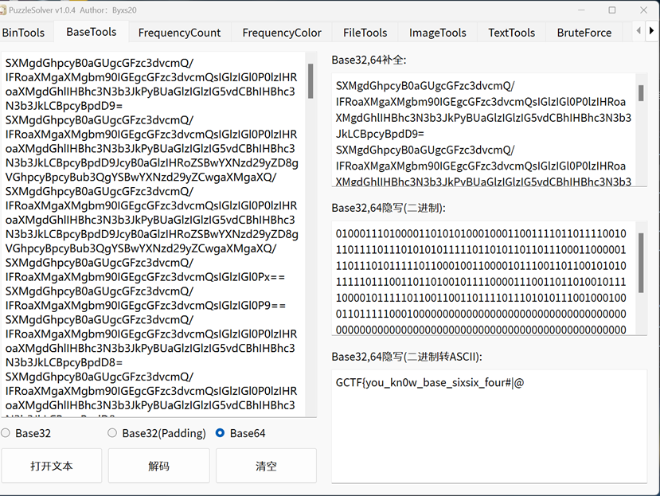
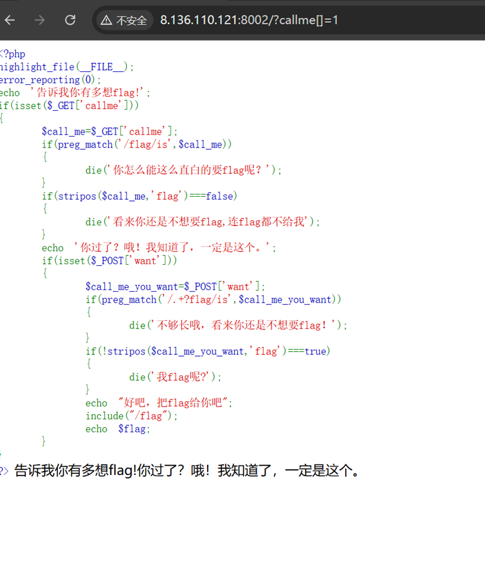
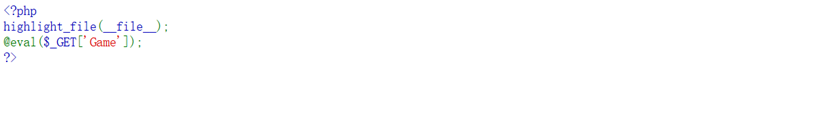
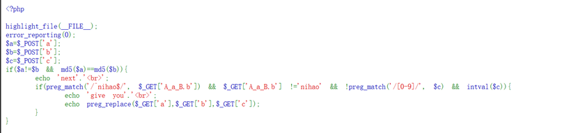

## MISC

### Checkin


### 签到题 cat 一下

社会主义编码翻译就是，有在线网站

嘿嘿，真的是无畏契约呢

一开始获得一个 base64 文本，可以解为图片二维码


扫一下得到（除了无畏契约啥也没有 qwq

换个思路运用工具二维码丢 stegsolve 里面用 data extract 出了


### 真的是 base64 哦



一串码，对它使用 base64 隐写工具梭哈吧！

### 送分的 Forensics 1 和送分的 Forensics 2

真送分喷不了，百度识图直接找得到，就是具体景点要一个个排除，有耐心应该都能做

一个好像是啥馆来着，另一个是仙女湖

### ez_python？

一个简单的脚本可以解决


得到数字后拿去给的网站加密一下就 ok 了（是大写的

## 密码学

### easy_xor

丢 AI 就出来了

### 一眼秒了

培根密码对照着就出来了

### Canon of Sherlock Holmes

开局拿到文本，颜文字解密秒了，然后发现 base64 不行了，发现是 aes，打开第二个文本 key，由查找发现是福尔摩斯跳舞的小人，对照


获得 key，然后 aes 得到 flag

### 一封来自提瓦特的信

找表翻译

[提瓦特语对照表](https://i-blog.csdnimg.cn/blog_migrate/c75f6c5e6b97def372cd8119aa93d62e.png)

注意是小写，我就傻了吧唧的大写半天没出来

### 梦回初一

一开始丢 AI 跑半天出不来，后来查资料发现又是挺标准的 **RSA**：利用 k 的等式化简为 p-1 的三次方乘以 q-1 的三次方，再利用 n=pq 求 p-1 乘以 q-1。计算量挺大，跑 AI 需要详细步骤；就那个 ∮n，然后跟着 AI 把值带入求解。

## Web

### in_~_check

没有啥技巧

打开开发者工具看看就出来了

### php_master

第一层用进制绕过


第二层用

```text
code=;}system('ls /');/*
```

发现没有根目录


最后就用

```text
code=;}system('env');/*
```

### 你到底多想要 flag???

提示给了数组和 pcre

那直接开整




查看一下就出来了

### 玩会游戏


得到


打开得到这个



用 get 传参就 ok 了

### Ezphp



代码审计，需要 a 和 b 碰撞，`a=QLTHNDT&b=QNKCDZO&c[]=a`，开整


第二层正则 `?A_a[B.b=nihao%0a` 成功绕过


第三层利用这个 preg_replace 函数

不会写脚本，只能求助我的 AI 朋友了


然后得出 flag

## Pwn

就写了个签到 cat 一下就好了

## Re

直接爆 0

## 题解

[赣CTF1.pdf](/img/gctf-2025/赣CTF1-20250226210720-p66ch6m.pdf)
